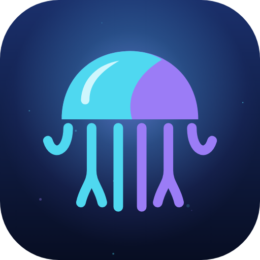

# Ephyra

A native Jellyfin client for Android phones, tablets and Android TV. Take your library on the road in
the quality you pick, play almost anything directly, from Dolby Vision to PGS subtitles, and watch on
a TV app that is made for the remote.

Ephyra started as a fork of [Findroid](https://github.com/jarnedemeulemeester/findroid) (see
[Built on Findroid](#built-on-findroid)) and was called **Findroid CE** until
[#169](https://github.com/midasvo/ephyra/issues/169). If you have Findroid CE, the update
installs over it and keeps your login, settings and downloads. An ephyra is the young stage of a
jellyfish, the animal in the Jellyfin logo.

## Why Ephyra?

- 📥 **Downloads that hold up** — a resumable download engine with SD card support, a quality for
  every download, whole seasons at once, and Smart Downloads that keep the next episodes ready.
- 🎬 **Plays what you throw at it** — Dolby Vision direct play, Atmos with an ffmpeg fallback, PGS,
  VobSub and DVB subtitles without transcoding, on ExoPlayer or mpv.
- 📺 **A real Android TV app** — a Home with a hero for the focused item, a player overlay with the
  next episodes, trickplay, Watch Next on the TV home screen and refresh rate switching
  (see [Android TV](#android-tv)).
- 🎛️ **Set up your way** — choose and order the Home rows, style the subtitles, and the audio and
  subtitle tracks you pick carry over to the next episodes.
- 🚀 **Moves fast** — new releases often, community contributions welcome, and dependencies and the
  Jellyfin SDK kept current with Renovate.
- 🔓 **Free and open** — GPLv3, no ads, and no data collected (see the [privacy policy](https://midasvo.nl/ephyra/privacy.html)).

## A look at Ephyra

<table>
  <tr>
    <td width="33%" align="center">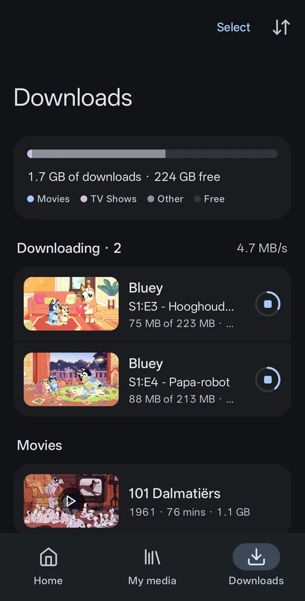<br><sub>Downloads with a storage breakdown</sub></td>
    <td width="33%" align="center">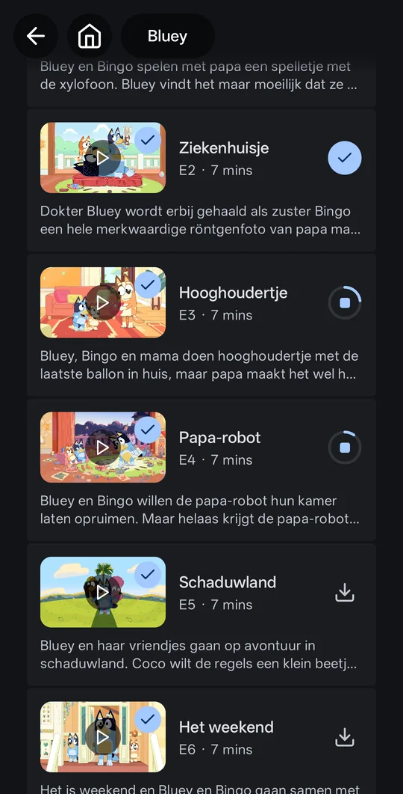<br><sub>Download progress per episode</sub></td>
    <td width="33%" align="center">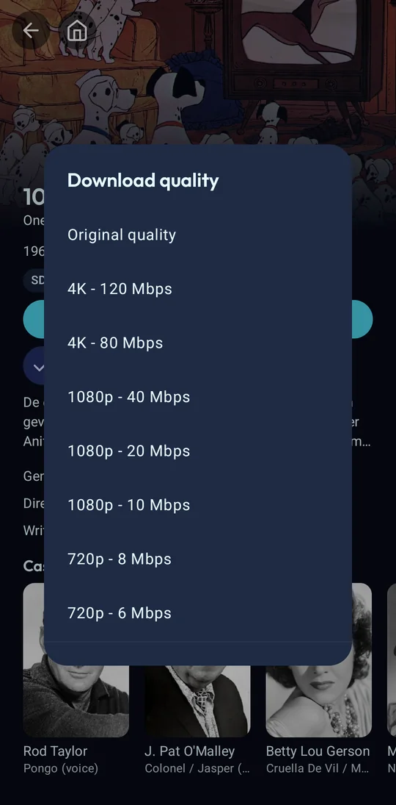<br><sub>A quality for every download</sub></td>
  </tr>
  <tr>
    <td align="center">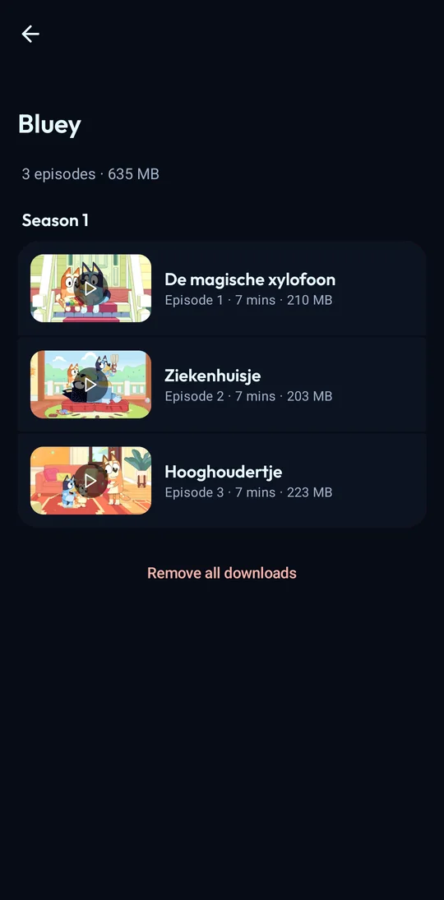<br><sub>A page per downloaded show</sub></td>
    <td align="center">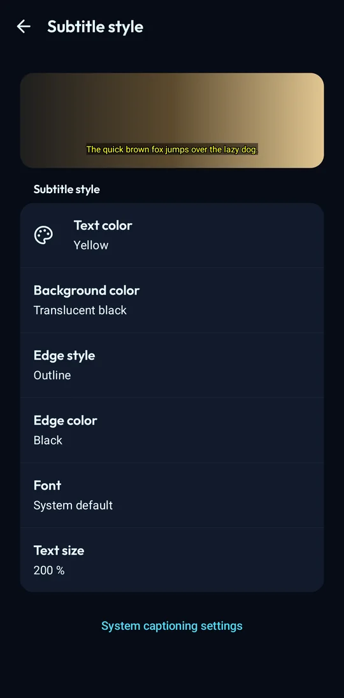<br><sub>Subtitle styling with a live preview</sub></td>
    <td align="center">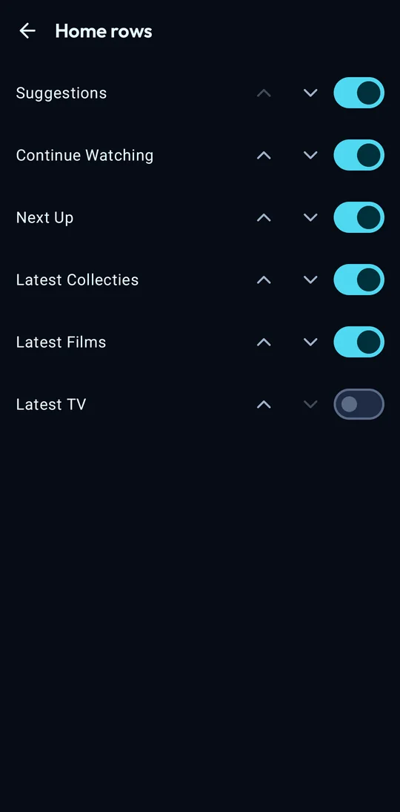<br><sub>Choose and order the Home rows</sub></td>
  </tr>
  <tr>
    <td colspan="3" align="center">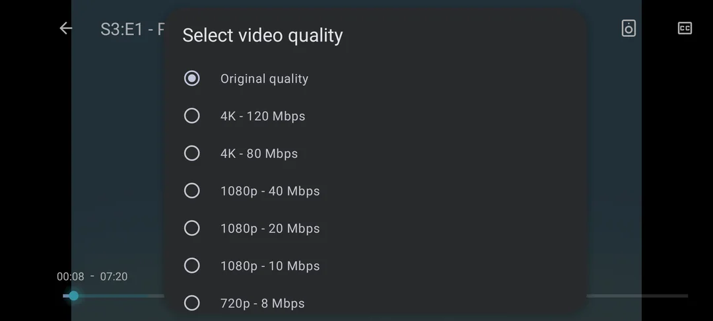<br><sub>Change the video quality during playback</sub></td>
  </tr>
</table>

<sub>All artwork shown belongs to its respective owners.</sub>

## Android TV

Ephyra has its own Android TV app, built for the remote. It uses the same login and the same server as
the phone app, and installs from the same releases (see [Install](#install)).

<table>
  <tr>
    <td colspan="2" align="center">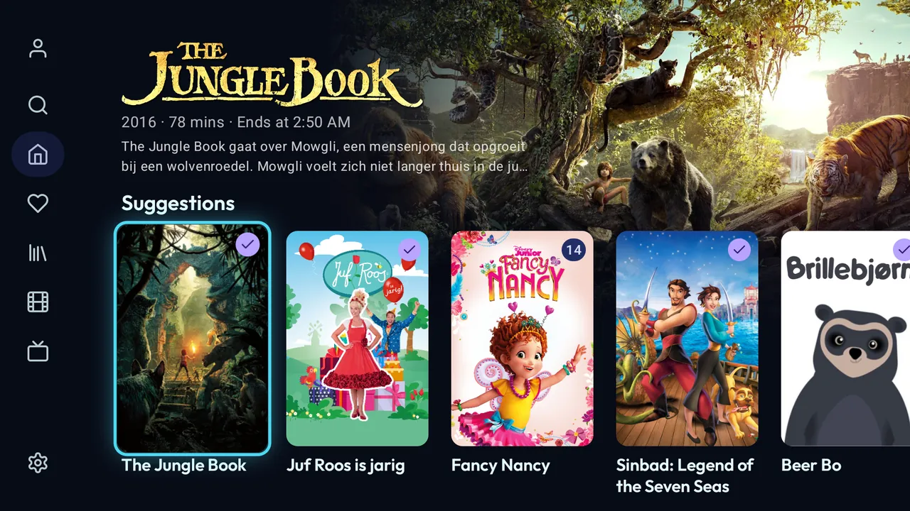<br><sub>Home with a hero for the focused item</sub></td>
  </tr>
  <tr>
    <td width="50%" align="center">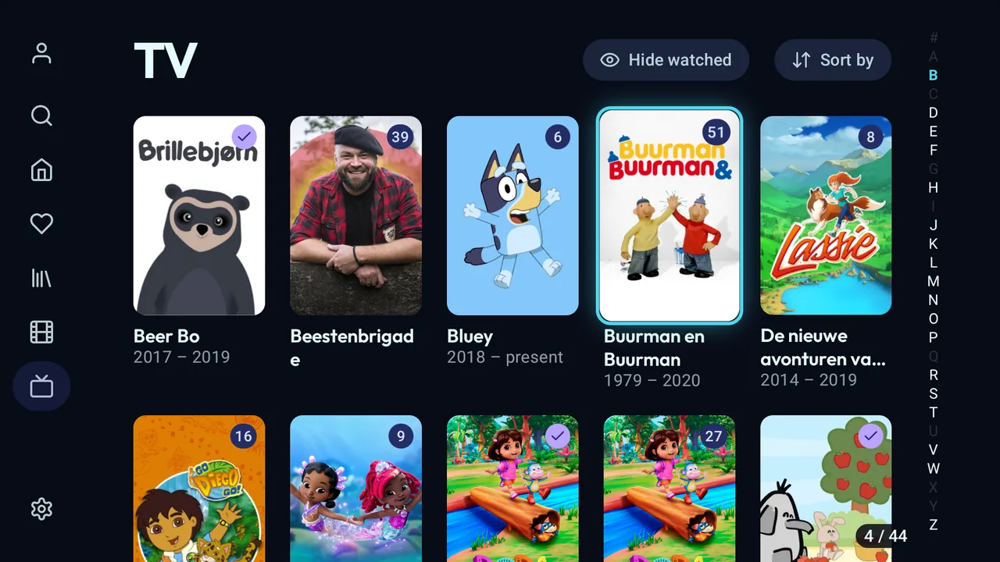<br><sub>Library grid with an A–Z jump bar</sub></td>
    <td width="50%" align="center">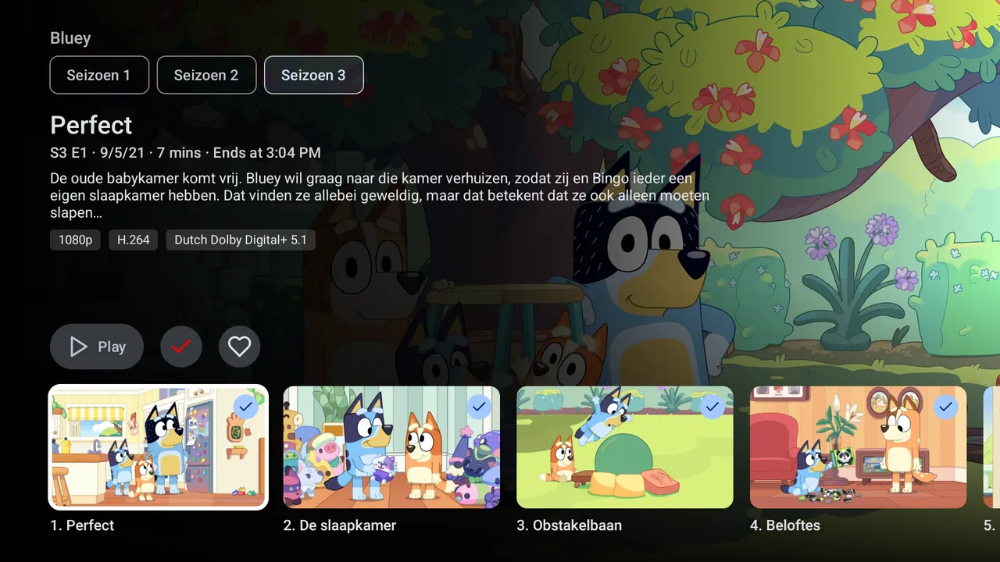<br><sub>Episodes open in their season</sub></td>
  </tr>
  <tr>
    <td align="center">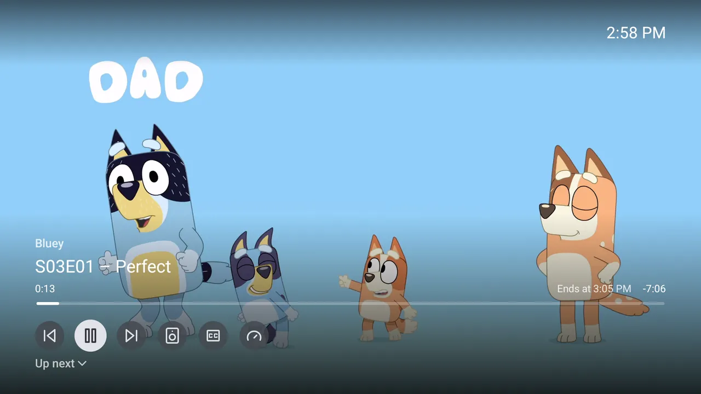<br><sub>Player overlay with the next episodes</sub></td>
    <td align="center">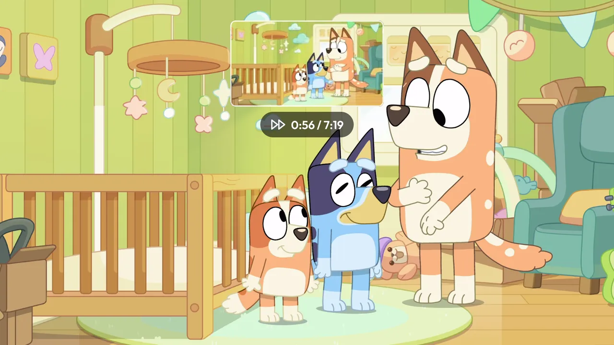<br><sub>Trickplay thumbnails while seeking</sub></td>
  </tr>
</table>

- **Side drawer** for Search, Home, Favorites, your libraries and Settings ([#127](https://github.com/midasvo/ephyra/issues/127)), with a favorites page ([#137](https://github.com/midasvo/ephyra/issues/137))
- **Home with a hero** that shows the focused item, and rows that don't reshuffle ([#132](https://github.com/midasvo/ephyra/issues/132)); pick and order the rows yourself ([#142](https://github.com/midasvo/ephyra/issues/142))
- **Search** across movies, shows and episodes ([#128](https://github.com/midasvo/ephyra/issues/128))
- **Library grid** with an A–Z jump bar, a counter and the hide-watched filter ([#135](https://github.com/midasvo/ephyra/issues/135))
- **Episodes open in their season** with details first, instead of playing straight away ([#130](https://github.com/midasvo/ephyra/issues/130)), plus cast and person pages ([#136](https://github.com/midasvo/ephyra/issues/136))
- **A player made for the remote**: seek with the D-pad, media keys, track dialogs ([#126](https://github.com/midasvo/ephyra/issues/126)), an overlay with the series, ends-at time, next/previous and a queue ([#131](https://github.com/midasvo/ephyra/issues/131)), and trickplay thumbnails ([#134](https://github.com/midasvo/ephyra/issues/134))
- **Refresh rate switching** to match the video's frame rate ([#139](https://github.com/midasvo/ephyra/issues/139))
- **Continue watching on the Android TV home screen** (Watch Next) ([#138](https://github.com/midasvo/ephyra/issues/138))
- **Screensaver** with artwork from your library ([#140](https://github.com/midasvo/ephyra/issues/140)) and optional **theme music** on show pages ([#141](https://github.com/midasvo/ephyra/issues/141))
- Collections, movie trailers and all relevant settings are reachable with the remote ([#129](https://github.com/midasvo/ephyra/issues/129)); phone-only settings are hidden ([#133](https://github.com/midasvo/ephyra/issues/133))

**Which APK:** the one ending in `-libre-tv-armeabi-v7a.apk` for 32-bit boxes such as the Xiaomi
Mi Box, and `-libre-tv-arm64-v8a.apk` for 64-bit ones. The Obtainium filters are under [Install](#install).

The research behind the TV app (gap analysis, decisions and the roadmap) is in
[docs/tv-research/](docs/tv-research/).

## Features

### Downloads

- **Resumable download engine** — built on OkHttp instead of Android's `DownloadManager`, with SD card support
- **Download quality picker** — keep the original, or have the server convert it, from 4K 120 Mbps down to 360p
- **Redesigned downloads screen** — one list with progress rings, a per-show page, multi-select, undo, and a storage breakdown
- **Season list built for downloads** — live progress and download, stop and delete buttons on each episode
- **Bulk season & series download** — with a configurable limit on concurrent downloads and per-season status such as "3/10 downloaded"
- **Smart Downloads** — an opt-in setting that keeps the next episodes of a series you are watching downloaded (3 by default) and removes the ones it downloaded once you have watched them

### Playback & player

- **Dolby Vision** — direct play where the device supports it, device-profile-aware transcoding on the rest
- **Better audio decoding** — tries the platform decoder first for Atmos, and falls back to ffmpeg if a decoder fails
- **Version picker & quality selector** — choose a version before playing, and change the video quality during playback
- **Next-season playback** — carries on into the next season, and autoplay can follow your server or be forced on or off
- **Audio and subtitle choice per series** — the audio and subtitle track you pick, or subtitles off, carry over to the next episodes of that series, on ExoPlayer and mpv and for downloads. Each user on the device keeps their own choice
- **Wider subtitle support** — PGS, VobSub, and DVB without transcoding, plus configurable colors, outline, font, and size
- **Media segments** — per-type skip / ask / ignore actions
- **Chapter list** in the player, and an **"Are you still watching?"** inactivity prompt
- **Background audio** (off by default) — keeps playing with the screen off or the app in the background, with artwork and controls on the lock screen. Turn it on under Settings → Player → Background playback; closing the picture-in-picture window then carries on as audio. The video is switched off in the background to save battery

### Library & UI

- **Customisable Home rows** — choose which rows Home shows and in what order, under Settings → Interface → Home rows (phone and TV)
- **Hide-watched filter** in the library view — persisted and shared across libraries
- **Long-press to copy text** on the movie/show/episode/season/person detail screens
- **Auto offline mode** — automatically enabled when there is no connectivity
- **Error screens with Retry** and proper empty states, instead of endless spinners and blank pages
- **Option to hide cast and crew** on detail screens

### Diagnostics

- **Export device profile** from the About screen — handy for debugging playback/transcoding

See the [changelog](CHANGELOG.md) for the full release-by-release history. Releases follow
[Semantic Versioning](https://semver.org/).

## Install

### Via Obtainium (recommended)

Add this repo URL in [Obtainium](https://github.com/ImranR98/Obtainium):

```
https://github.com/midasvo/ephyra
```

Obtainium then checks for new releases automatically and notifies you of updates. Leave
**Include prereleases** off for this entry so it only follows stable releases.

Already following `https://github.com/midasvo/findroid-ce`? GitHub redirects the old URL, so that
entry keeps getting updates.

On **Android TV**, set **Filter APKs by regular expression** to `.*-tv-armeabi-v7a\.apk` for 32-bit
boxes such as the Xiaomi Mi Box (`.*-tv-arm64-v8a\.apk` for 64-bit ones). On a phone,
`-libre-arm64-v8a\.apk$` keeps Obtainium from offering the TV APK.

<details>
<summary><strong>Beta channel (Obtainium)</strong></summary>

Beta builds of `main` and of work in progress are published as GitHub prereleases tagged
`v<next version>-beta.<n>`, such as `v2.0.1-beta.12`. They install as a separate app, **Ephyra Beta**
(`nl.midasvo.findroid.ce.staging`), with its own data, so they never replace the stable app.

To follow them, add the same repo URL in Obtainium a second time with these settings:

- **Include prereleases**: on
- **Filter release titles by regular expression**: `^Beta`
  (skips stable releases, which can be newer than the latest beta right after a release)
- **Filter APKs by regular expression**: `-beta\.\d+-libre-arm64-v8a\.apk$`
  (swap `arm64-v8a` for your device's ABI if needed; on Android TV use
  `-beta\.\d+-libre-tv-armeabi-v7a\.apk$`)

Betas are untested builds — expect bugs. Every push to `main` publishes one.

</details>

### Via F-Droid

<a href="https://f-droid.org/packages/nl.midasvo.findroid.ce/">
  
</a>

Ephyra is available on [F-Droid](https://f-droid.org/packages/nl.midasvo.findroid.ce/).
The F-Droid build is verified against our GitHub releases via reproducible builds.

### Manual

Grab the latest APK from the [Releases](https://github.com/midasvo/ephyra/releases) page:
`ephyra-v<version>-libre-<abi>.apk` for phones and tablets, or
`ephyra-v<version>-libre-tv-<abi>.apk` for Android TV (`armeabi-v7a` for 32-bit boxes such as the
Xiaomi Mi Box). Phone and TV share one application ID, so installing the TV APK over the phone APK
keeps your login.

> Ephyra has its own application ID (`nl.midasvo.findroid.ce`), so it can be installed next to
> Findroid.

## Built on Findroid

Ephyra grew out of [Findroid](https://github.com/jarnedemeulemeester/findroid). Its foundations,
the native UI, ExoPlayer and mpv playback, offline mode and picture-in-picture, come from there, and
Findroid's improvements are still merged in regularly (see [docs/upstream-sync.md](docs/upstream-sync.md)).
Thanks to [Jarne Demeulemeester](https://github.com/jarnedemeulemeester) and the
[Findroid contributors](https://github.com/jarnedemeulemeester/findroid/graphs/contributors).

## License

GPLv3. See [LICENSE](LICENSE).

The Ephyra icon was made for this project; its sources and the script that generates them are in
[images/branding/ephyra/](images/branding/ephyra/).
