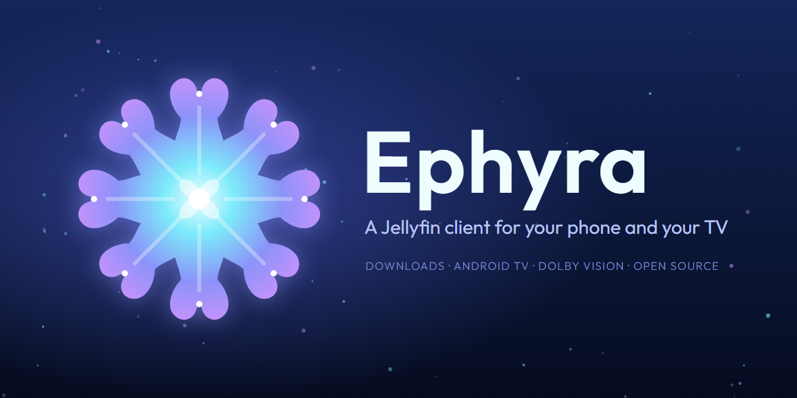

<p align="center">
  
</p>

<p align="center">
  <a href="https://github.com/midasvo/ephyra/releases/latest"></a>
  <a href="LICENSE"></a>
</p>

<p align="center">
  <a href="https://midasvo.nl/ephyra/">Website</a> ·
  <a href="#install">Install</a> ·
  <a href="#what-ephyra-adds-to-findroid">What Ephyra adds</a> ·
  <a href="#android-tv">Android TV</a> ·
  <a href="#bugs-and-contributions">Bugs and contributions</a> ·
  <a href="#privacy">Privacy</a>
</p>

Ephyra is a Jellyfin client for Android phones, tablets and Android TV, forked from
[Findroid](https://github.com/jarnedemeulemeester/findroid). It needs a
[Jellyfin](https://jellyfin.org/) server and Android 10 or newer.

<table>
  <tr>
    <td width="33%" align="center"><br><sub>Downloads, with a storage breakdown</sub></td>
    <td width="33%" align="center"><br><sub>Download progress per episode</sub></td>
    <td width="33%" align="center"><br><sub>Every download asks for a quality</sub></td>
  </tr>
  <tr>
    <td align="center"><br><sub>A page per downloaded show</sub></td>
    <td align="center"><br><sub>Subtitle styling, with a live preview</sub></td>
    <td align="center"><br><sub>Choose and order the Home rows</sub></td>
  </tr>
  <tr>
    <td colspan="3" align="center"><br><sub>Change the video quality during playback</sub></td>
  </tr>
</table>

<sub>All artwork shown belongs to its respective owners.</sub>

## Install

### Obtainium

Add `https://github.com/midasvo/ephyra` in [Obtainium](https://github.com/ImranR98/Obtainium).
Leave **Include prereleases** off and set **Filter APKs by regular expression**:

| Device | Filter |
|---|---|
| Phone or tablet | `-libre-arm64-v8a\.apk$` |
| Android TV, 64-bit | `.*-tv-arm64-v8a\.apk` |
| Android TV, 32-bit (Xiaomi Mi Box and similar) | `.*-tv-armeabi-v7a\.apk` |

### Releases page

Download from [Releases](https://github.com/midasvo/ephyra/releases):
`ephyra-v<version>-libre-<abi>.apk` for phones and tablets, `ephyra-v<version>-libre-tv-<abi>.apk`
for Android TV. Nearly everything is `arm64-v8a`; 32-bit TV boxes need `armeabi-v7a`.

### F-Droid

[Submitted](https://gitlab.com/fdroid/fdroiddata/-/merge_requests/56048), waiting for review. The
build is reproducible and verified against the GitHub APKs, so once listed you can switch sources
without reinstalling.

### Coming from Findroid CE or Findroid

- Ephyra was Findroid CE until 2.0.0. The update installs over it and keeps your login, settings and
  downloads. An Obtainium entry for `midasvo/findroid-ce` keeps working; GitHub redirects it.
- Ephyra has its own application ID (`nl.midasvo.findroid.ce`), so it installs next to Findroid.
  Phone and TV share that ID.

### Beta

Every push to `main` publishes a prerelease, `v<next version>-beta.<n>`. It installs as a separate
app, **Ephyra Beta**, with its own data. Untested; expect bugs.

Obtainium: add the repository URL again with **Include prereleases** on, **Filter release titles by
regular expression** `^Beta`, and **Filter APKs by regular expression**
`-beta\.\d+-libre-arm64-v8a\.apk$` (TV, 32-bit: `-beta\.\d+-libre-tv-armeabi-v7a\.apk$`). The title
filter stops the entry from switching to stable right after a release.

## What Ephyra adds to Findroid

**Downloads**

- Resumable, with SD card support. Built on OkHttp, not Android's DownloadManager.
- A quality per download: the original, or a server conversion from 4K down to 360p.
- Whole seasons or series at once, with a limit on concurrent downloads.
- Downloads screen with progress per episode and per show, a storage breakdown, multi-select and undo.
- Smart Downloads (opt-in): keeps the next episodes of what you're watching, removes them once watched.

**Playback**

- Dolby Vision direct play where the device supports it, transcoding where it doesn't. Dolby Vision
  downloads can be converted to a device-compatible copy.
- Platform decoder first (Atmos), ffmpeg if a decoder fails.
- PGS, VobSub and DVB subtitles without transcoding. Subtitle colour, outline, font and size.
- Version picker before playing, quality switch during playback.
- Audio and subtitle choice remembered per series and per user, on ExoPlayer, mpv and downloads.
- Plays on into the next season. Chapter list. Skip, ask or ignore per media segment type.
  "Still watching?" prompt after a run of autoplayed episodes.
- Background audio with lock screen controls (opt-in, Settings → Player → Background playback).

**Library**

- Favorites tab.
- Home rows you choose and reorder (Settings → Interface → Home rows).
- Hide-watched filter, kept across libraries.
- Offline mode switches on by itself without a connection.
- Error screens with Retry, and real empty states.
- Long-press to copy text on detail screens. Option to hide cast and crew.

**Android TV**: a separate app built for the remote, [below](#android-tv).

The rest is Findroid's, and Findroid's changes are merged in regularly. Release-by-release detail
is in the [changelog](CHANGELOG.md).

## Android TV

<table>
  <tr>
    <td colspan="2" align="center"><br><sub>Home, with a hero and a glow for the focused item</sub></td>
  </tr>
  <tr>
    <td width="50%" align="center"><br><sub>Library grid with an A to Z jump bar</sub></td>
    <td width="50%" align="center"><br><sub>Episodes open in their season</sub></td>
  </tr>
  <tr>
    <td align="center"><br><sub>Player overlay with the next episodes</sub></td>
    <td align="center"><br><sub>Trickplay thumbnails while seeking</sub></td>
  </tr>
</table>

Same login and server as the phone app, same releases (the `-tv-` APKs). Built for the remote:

- Side drawer: Search, Home, Favorites, your libraries, Settings.
- Home with a hero for the focused item. Rows stay put; you choose and order them.
- Library grid with an A to Z jump bar, a counter and the hide-watched filter.
- Episodes open in their season, details first. Cast rows and person pages.
- Player: D-pad seeking, media keys, trickplay thumbnails, an overlay with the series, end time,
  previous, next and the queue.
- Refresh rate switching to match the video.
- Continue Watching and Next Up in the Android TV home screen's Watch Next row.
- Screensaver with your library's artwork. Optional theme music on show pages.
- Collections, trailers and settings all reachable with the remote. Phone-only settings are hidden.

Background and roadmap: [docs/tv-research/](docs/tv-research/).

## Bugs and contributions

[Open an issue](https://github.com/midasvo/ephyra/issues). For playback problems, attach the device
profile from About → Export device profile.

Pull requests are welcome. Start with [CLAUDE.md](CLAUDE.md) for the module layout,
[docs/identity/VISION.md](docs/identity/VISION.md) for the visual identity and
[docs/upstream-sync.md](docs/upstream-sync.md) for how Findroid's changes come in.

```bash
./gradlew :app:phone:assembleLibreDebug
```

Strings shared with Findroid are translated on Findroid's Weblate. Ephyra's own live in
`strings_ce.xml` files, in 36 languages; fixes go in a pull request.

## Privacy

Ephyra collects nothing and only talks to the Jellyfin servers you add.
[Privacy policy](https://midasvo.nl/ephyra/privacy.html).

## Thanks

[Findroid](https://github.com/jarnedemeulemeester/findroid) by
[Jarne Demeulemeester](https://github.com/jarnedemeulemeester) and its
[contributors](https://github.com/jarnedemeulemeester/findroid/graphs/contributors).

An ephyra is a young jellyfish, the animal in the Jellyfin logo. The icon and banner were made for
this project: [images/branding/ephyra/](images/branding/ephyra/).

## License

[GPLv3](LICENSE). The Outfit font is used under the
[SIL Open Font License 1.1](core/OUTFIT-LICENSE.txt).
