# Phase 2: walkthrough on a 10.5" tablet

The debug build of `main` (`ab64c3b9`) on the `ce_tablet_tmp` AVD (1280×800 dp), landscape and portrait, demo server. Findings are numbered *T1*…; later documents refer to them. Screenshots are in [screenshots/](screenshots/), scaled to 1024 px.

**Verdict in one line:** the shell (navigation rail, grids, setup, settings) is already adaptive and looks fine; every page *about an item* is a phone layout stretched to 1280 dp, and the player ignores the tablet entirely.

## What works

- **Home**: navigation rail on the left in both orientations, carousel with 3 pages (landscape) or 2 (portrait), rows and cards scale. 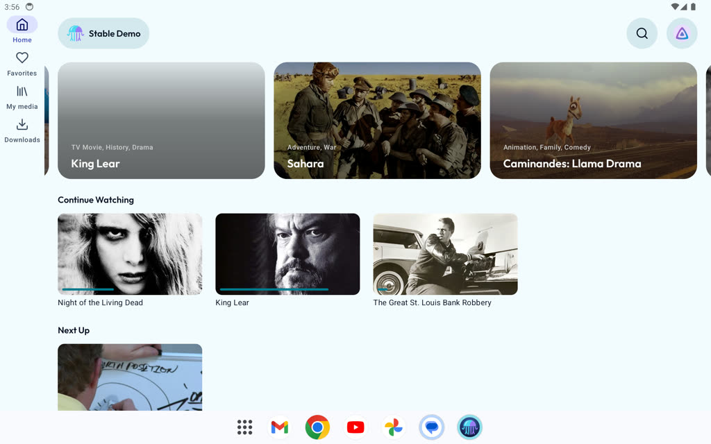 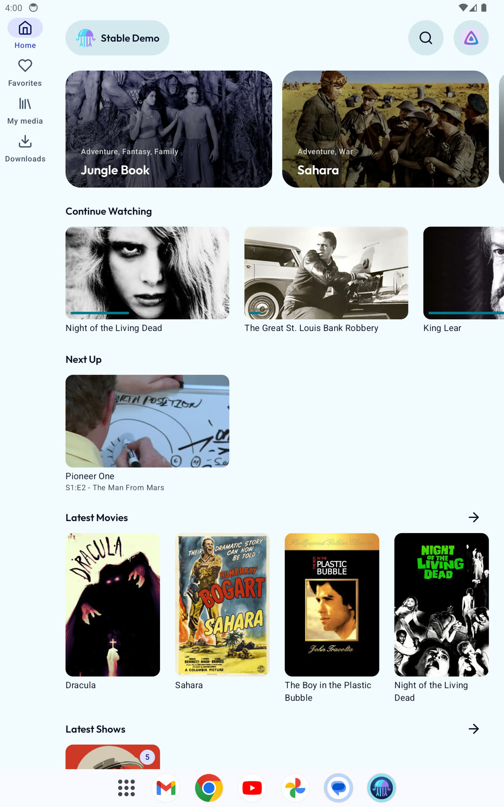
- **Library grid**: 6 poster columns in landscape, 4 in portrait. Search results use the same grid.
- **Settings, About, setup**: centred columns of 640 / 480 dp. 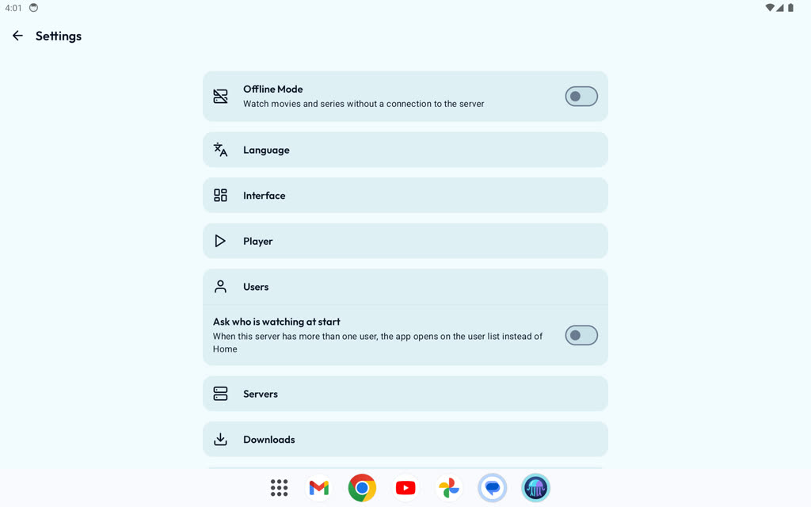 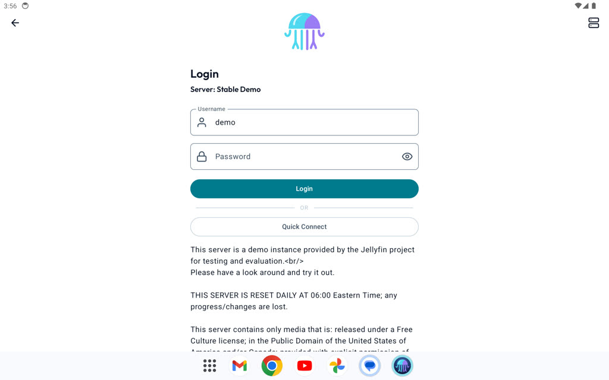
- **Person**: already a two-column layout at 600 dp+. 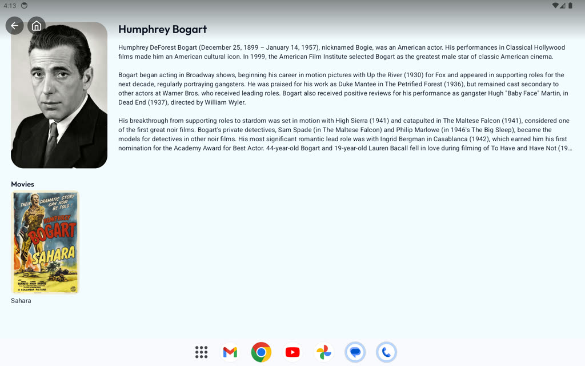
- **Split-screen at 600 dp**: the app keeps the rail, the carousel drops to 1 page, nothing overflows. 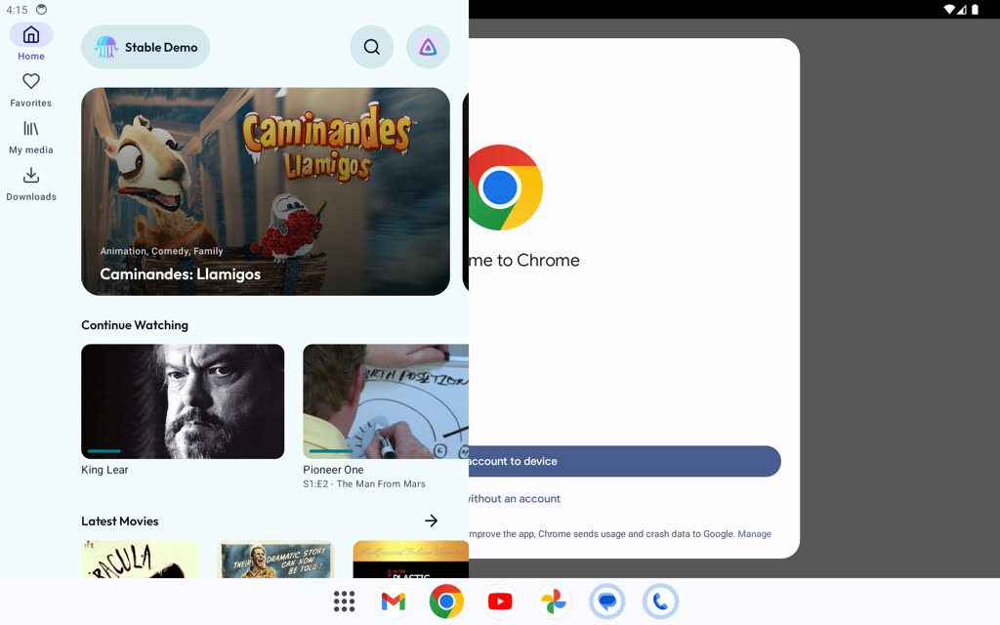
- **Player**: plays, controls are reachable, the seek bar is usable. 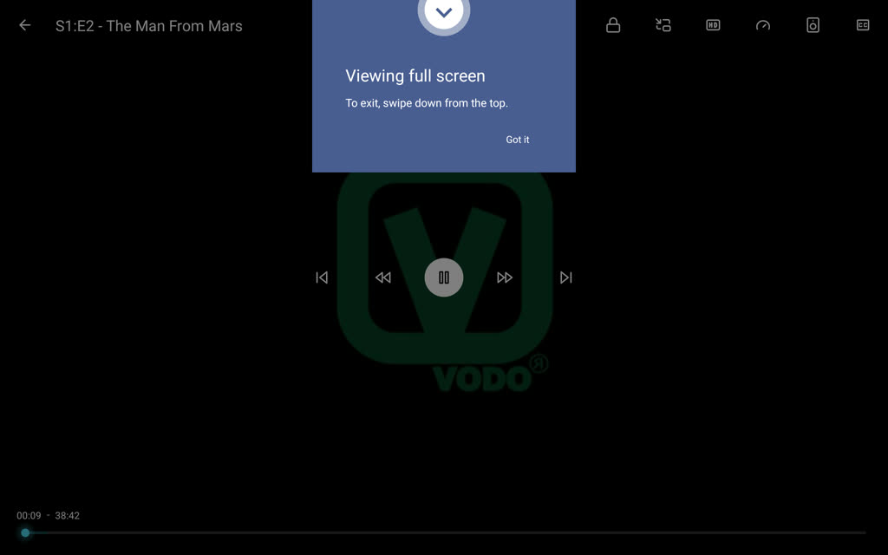

## Findings

| # | Where | Finding | Severity |
|---|---|---|---|
| T1 | Movie, Show, Season, Episode | **Backdrop is a thin, zoomed-in strip.** `ItemHeader` was a fixed 288 dp tall with `ContentScale.Crop`; at 1280 dp wide a 16:9 backdrop is cropped to 4.4:1. Sahara shows helmets, the episode shows a piece of whiteboard. 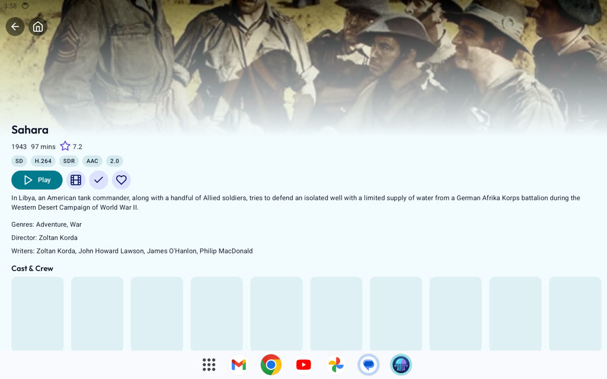 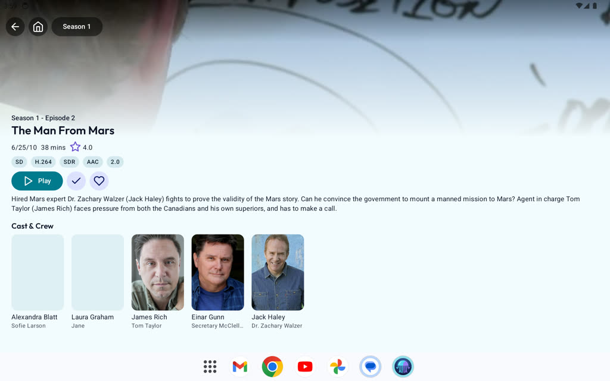 | Must. **Fixed** on this branch, see below. |
| T2 | Movie, Show, Episode | **Text runs the full 1280 dp.** Overview lines of 130+ characters; the metadata, chips and buttons hug the left edge with 60 % of the window empty. | Must. **Fixed** (720 dp cap). |
| T3 | Season | **Episode rows span the window**: 105 dp thumbnail, 1100 dp of text, download button at the far right. 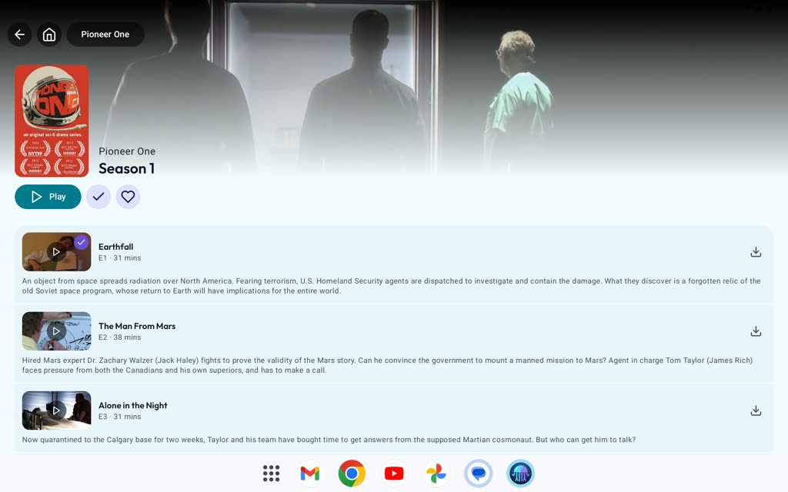 | Must. **Fixed** (720 dp cap). |
| T4 | Movie, Show, Episode | **Below the fold is empty.** After the fix the detail page still uses only the top-left: in landscape the lower 40 % of the window holds nothing but the cast row; in portrait it is half empty. The page needs a two-column layout, not a cap. | Must |
| T5 | Show | **Next Up card is 420 dp wide** on its own line; seasons row and cast row are full width under a 720 dp text column. Mixed widths look accidental. 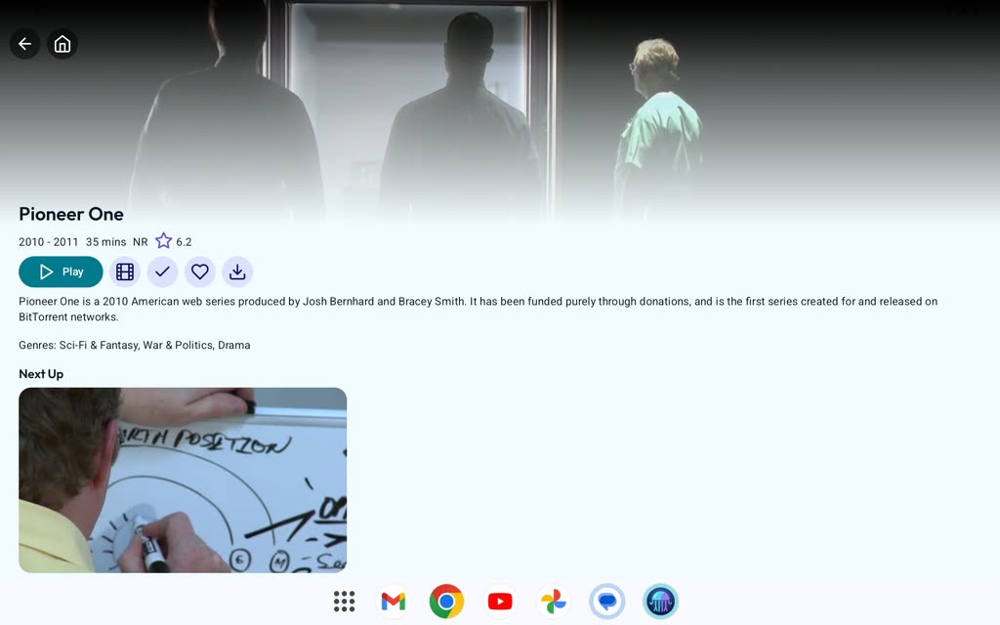 | Should |
| T6 | Player | **Volume and brightness zones are each half the screen** (`viewCenterX`). On a 1280 dp window a swipe 500 dp from the edge still changes volume; the tap-to-show-controls region is effectively the whole screen but any vertical movement becomes a gesture. Same as upstream #1144. | Must |
| T7 | Player | **Forced landscape.** `sensorLandscape` on a tablet means a portrait tablet (or a folded/book-posture foldable) rotates the whole UI for the player, then back. Tier 3 of the adaptive guidelines says apps should "let people use their preferred orientation". | Should |
| T8 | Player | **Controls are phone-sized at 3× the width**: transport buttons clustered in the centre, 272 dp trickplay preview, 64 dp gesture panels, titles at the same sp. Nothing uses the extra room (no chapter strip, no episode list, no queue). | Should |
| T9 | Media screen | **Search bar is 1100 dp wide.** The M3 search bar fills the width; on expanded windows it should be capped or become a docked field in the rail/top area. | Should |
| T10 | Home | **Continue Watching cards are 260 dp** regardless of width: in landscape 3.5 fit, in portrait 2.5. The carousel adapts, the rows don't, so the page has three different rhythms. | Should |
| T11 | Downloads / Favorites | **Title position differs**: Favorites puts the title at the top; Downloads puts the sort button above the title, so the title sits 80 dp lower. | Polish |
| T12 | Movie, Show, Season (dark backdrops) | **Status bar text unreadable** over a dark backdrop: dark icons on dark art. On phones the backdrop is shorter so it shows less. A `scrimOverArt` top gradient or a light status bar while over the header fixes it. | Should |
| T13 | Dialogs | `DownloadQualityDialog`, sort and user sheets rely on M3 defaults; the user bottom sheet in portrait is 1200 of 1600 px wide. Tier 2 asks that sheets "are not full width on large screens". | Polish |
| T14 | Setup | Login disclaimer shows a literal ` ` (server HTML, `LoginScreen.kt:244`). Not a tablet bug, but the 480 dp column makes it a 7-line block that stands out. | Polish |
| T15 | Keyboard / mouse | Not tested on the emulator; by inspection there are no keyboard shortcuts in the player (Space, arrows, Esc) and no hover states on cards. Tier 2 items. | Should |

Not tested: foldable postures (no foldable AVD yet), desktop windowing, stylus, a real tablet's refresh rate and memory.

## Fixed on this branch (2026-11-07)

Two changes, verified on the tablet AVD and on a simulated 412×915 dp phone (unchanged there):

1. `ItemHeader` height = `max(288 dp, min(width × 9/16, window height × 0.5))`. Landscape tablet: 400 dp; portrait: 450 dp; phone: 288 dp as before.
2. `DetailContentMaxWidth = 720.dp` on the text column of Movie, Show, Episode and on the Season episode cards.

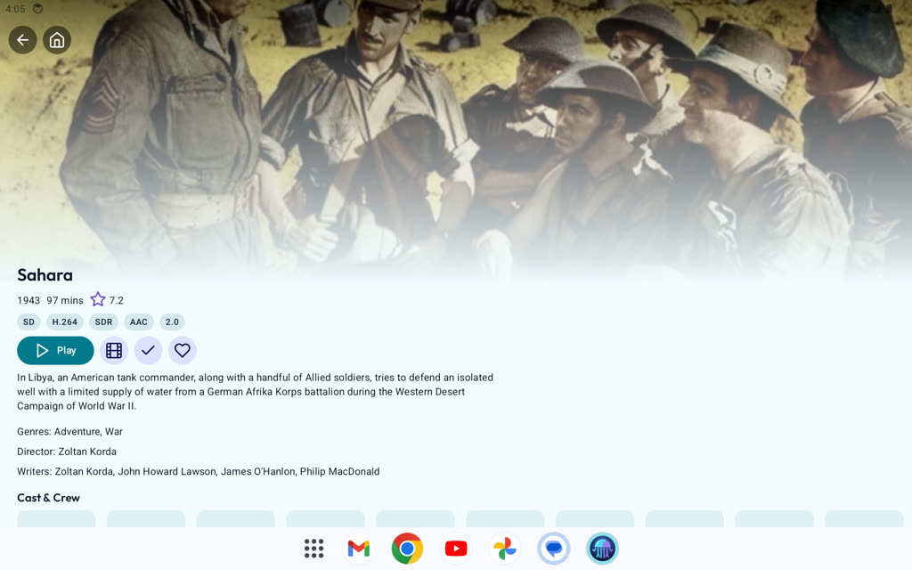 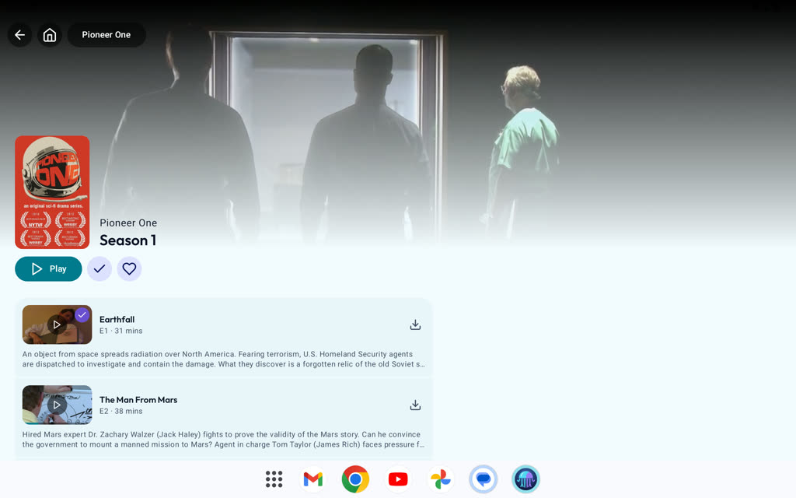

These are stop-gaps. They make the pages readable; the design in [4-design.md](4-design.md) replaces the single column with a real tablet layout.

**R6 (player orientation and edge gestures):** `PlayerActivity` no longer forces `sensorLandscape` from the manifest. It picks the orientation at runtime: forced landscape when the full-screen window's shorter side is under 600 dp (phones, folded foldables), unspecified otherwise, so a tablet plays in portrait (T7). On a player at least 840 × 480 dp, brightness and volume swipes only start within `clamp(width × 0.2, 96 dp, 240 dp)` of the left or right edge; a vertical swipe in the middle does nothing (T6, upstream #1144). Verified on a 1280×800 dp tablet AVD in both orientations and on the same AVD resized to a 411×914 dp phone.

**R4** (rows, grids, search bar, Downloads): cards, grid cells and the Downloads grid take their sizes from the `Layout` tokens (320 dp cards and 180 dp cells at expanded, unchanged on a phone), the Media search bar is capped at 720 dp, and Downloads puts its title at the top like Favorites on wide windows. Verified on the 1280 by 800 dp tablet AVD and a 411 dp phone window.

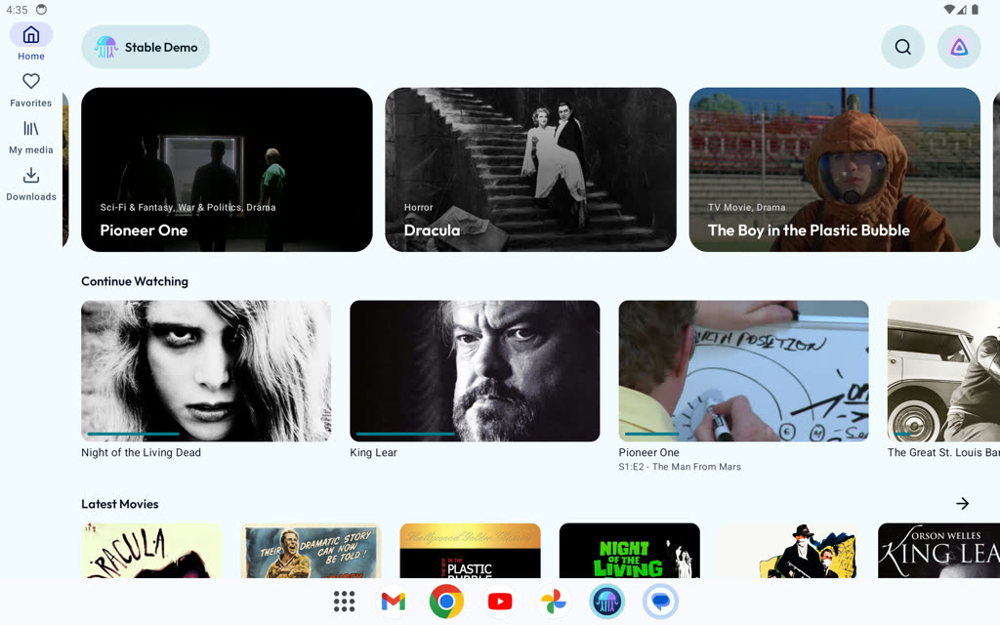 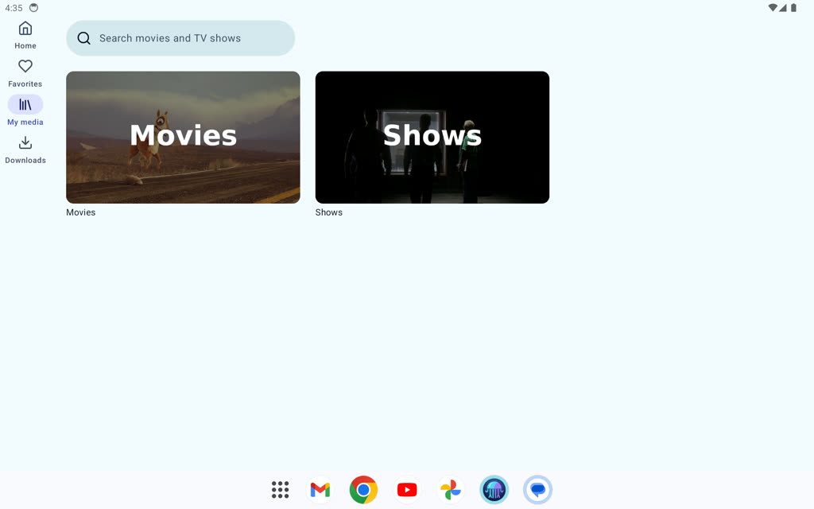
