# Phase 1: walkthrough on an emulator

The TV debug build (`d113b8b6`, `tv-libre-x86-debug.apk`) ran on an Android TV emulator: Android 14, x86, 1080p, 2 GB RAM. That matches the box's Android version and its 32-bit userspace. It was logged in to the real Kiddos server and driven only with D-pad, OK and Back key events. The Xiaomi box was not used. Its final check comes later.

The code inventory is in [1-inventory.md](1-inventory.md).

### Confirmed on the device

| # | What | Rule | Severity |
|---|---|---|---|
| 1 | **The Search tab is empty.** OK on Search shows a blank page, and Down goes nowhere. | 1 | Must fix |
| 2 | **No seeking with the remote.** With the controls hidden, Left/Right do nothing (the episode just kept playing from 9:41). With the controls shown, Right from play/pause jumps to the subtitle button. The seek bar never takes focus, so there's no way to seek at all. When the bar is selected in code, a step is 5% of the length: about 1 min in an episode, about 6 min in a 2-hour film. | 1 | Must fix |
| 3 | **The audio and subtitle buttons in the player do nothing.** | 1 | Must fix |
| 4 | **Focus is lost after Back, on every level:** player → Home: focus goes to the Search tab. Season → show: focus goes to Play and the page scrolls back to the top, not to the season card. Show → library: focus lands on another card one row up (Keys instead of Paw Patrol). Library → Libraries: focus goes to the first library (Collections instead of TV). | 2 | Must fix |
| 5 | **Collections are a dead end.** OK on a collection (e.g. Aladdin Collection) does nothing. `LibraryScreen` handles movies, shows and folders, but not `FindroidBoxSet`. | 1 | Must fix |
| 6 | **Settings below "Play next episode automatically" can't be reached.** Focus stops there, while the "Still watching prompt" group and everything after it are on screen below. | 1, 2 | Must fix |
| 7 | **Some settings don't apply on TV:** Trickplay (TV has no trickplay) and, according to the code, the player gestures. The media-segment options appear twice: once as "Show skip button / Auto skip" and once per type (Recaps, Previews, Commercials: "Not set"). | 9 | Should fix |
| 8 | **Content cut off at the screen edge:** in a Home row, after scrolling the first card starts at x≈8 px. The show page opens with the title against the top edge (y≈0). The suggestions carousel ends up half off-screen. All of this falls outside the 48/27 dp safe area. | 3 | Should fix |
| 9 | **The suggestions carousel shows no focus.** When it has focus, nothing on screen shows it. Focus seems to be "gone" until the next press. | 2, 3 | Should fix |
| 10 | **Tabs switch only on OK.** Moving focus to Libraries doesn't change the content. When the content loads, the Libraries screen takes focus away from the tab row. | 1 | Polish |
| 11 | **Back on Home exits the app right away.** No confirmation, and focus doesn't go back to the tab row first. | 1 | Discuss in phase 4 |
| 12 | **An episode from Home or a season starts playing right away.** There's no episode page with an overview, versions or tracks. | n/a | Feature gap |
| 13 | **Settings use one third of the width** (the right two thirds stay empty until an item opens a detail panel). | 3 | Polish |
| 14 | **Small things:** the movie date is in US format (`1/25/61`) with a Dutch UI language. The app shows as "Findroid", not "Findroid CE", on the welcome screen. The player shows only the episode title, not the series. A show without a poster shows an empty dark card with no title on it. | n/a | Polish |

### What already works well

- The setup flow, library grid (5 columns, paging, sort, watched filter), show page with backdrop, season list and movie page all work with the remote.
- Playback itself works: direct play started within a few seconds on the emulator, and the resume position was correct.
- The settings detail panels (radio, check and switch lists) work with D-pad and give a good model for the rest of the app.

### About 4K

I didn't test it separately. Android TV runs a 4K panel at the same dp size as 1080p (3840×2160 at density 640 = 1920×1080 dp), so the layout is the same. On 4K, the only differences are artwork sharpness and how much memory decoded images take. Those belong to the image-size work from #114 and to measurements on the box. The 4K emulator image (`ce_tv_4k`) is set up for when it's needed.

### Phase 1 status

- [x] Code inventory and feature matrix ([1-inventory.md](1-inventory.md))
- [x] Walkthrough on an emulator (this page)
- [ ] Final check on the Xiaomi box: frame times and memory while scrolling a large library, and Dolby Vision. This waits until the box is free.

Next step: phase 2, Wholphin. It's already installed on the box, and can also go on the emulator so the comparison doesn't need the box.

### Screenshots

Taken on the emulator at 1080p, scaled to 1280 px wide.

| | |
|---|---|
| Home, focus on the tab row 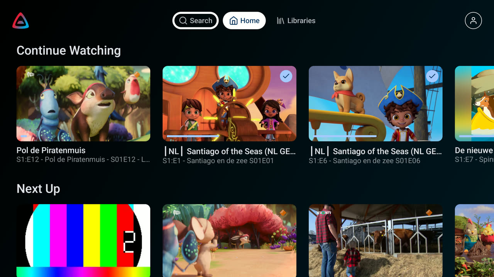 | Search tab is empty (finding 1) 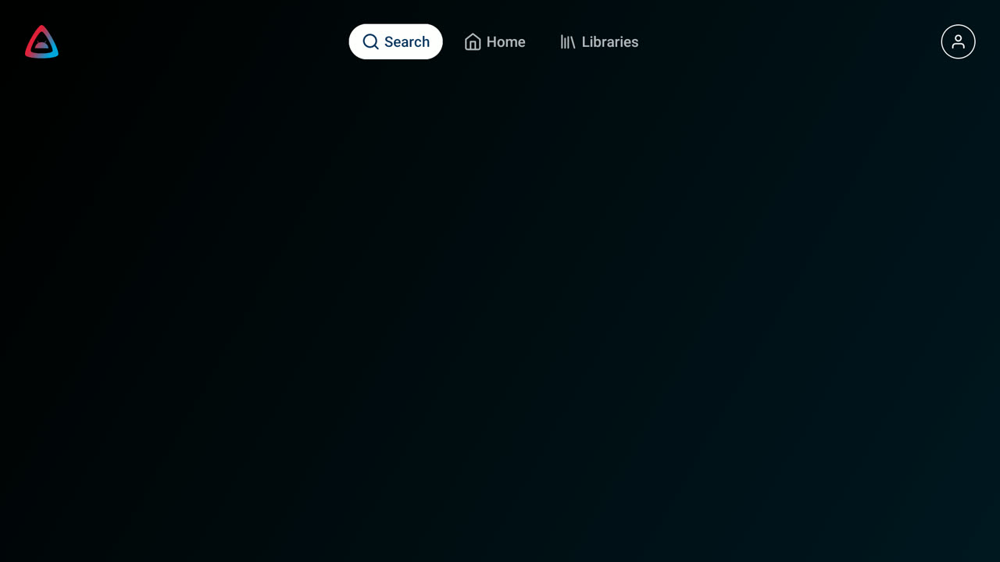 |
| Home row after moving down: first card against the edge (finding 8) 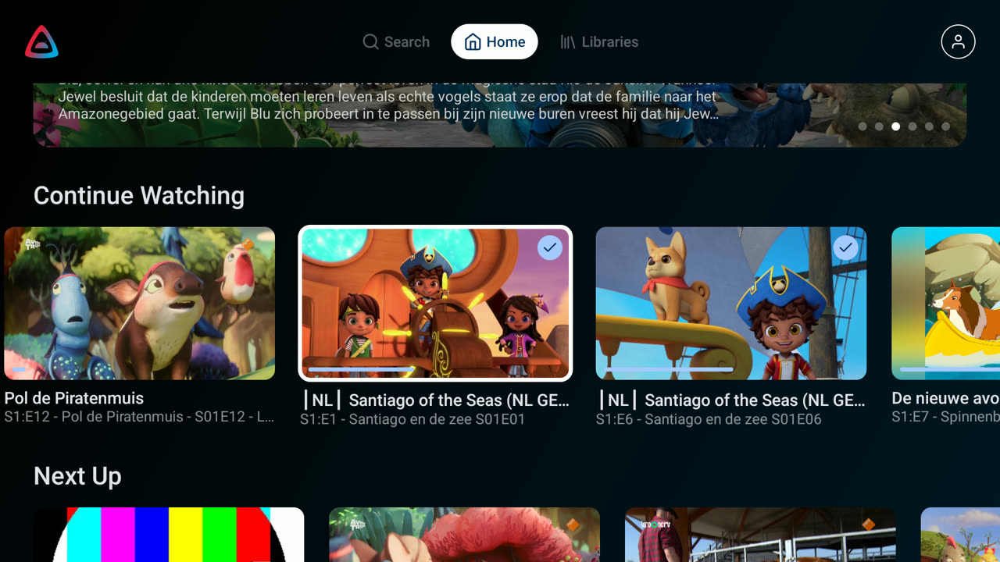 | Player controls 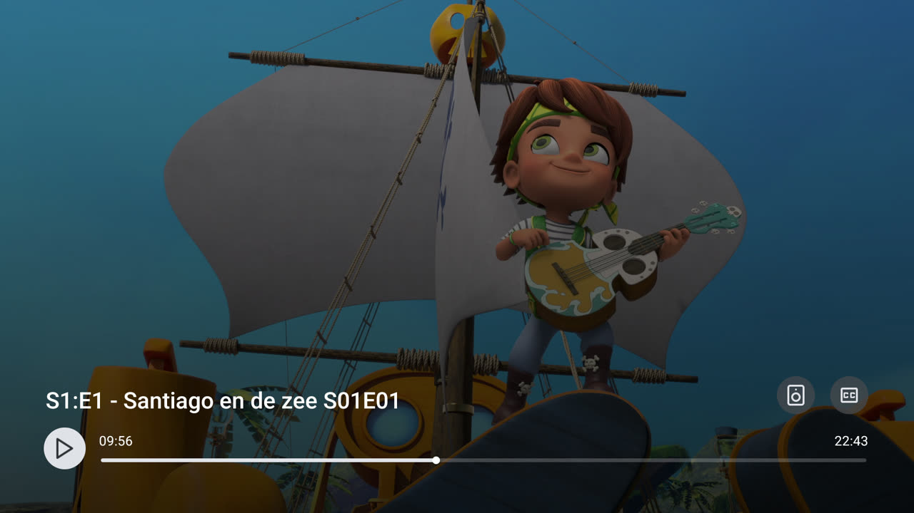 |
| Focus order in the player: play → CC → audio, the seek bar is skipped (finding 2) 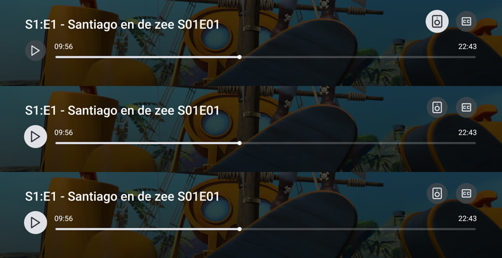 | Back from the player: focus on the Search tab (finding 4) 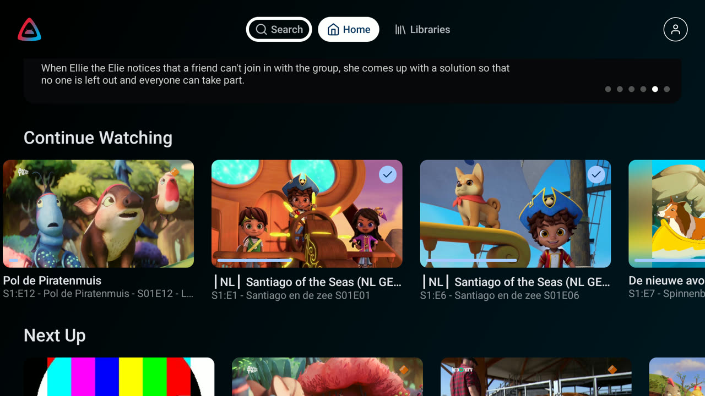 |
| Library grid 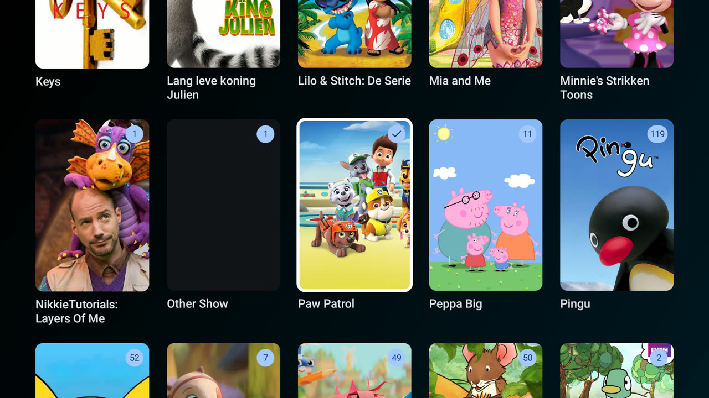 | Show page: title against the top edge (finding 8) 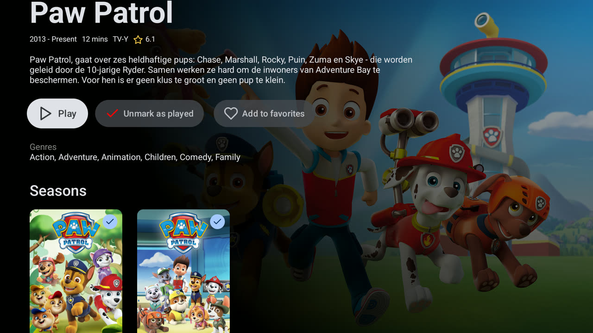 |
| Season 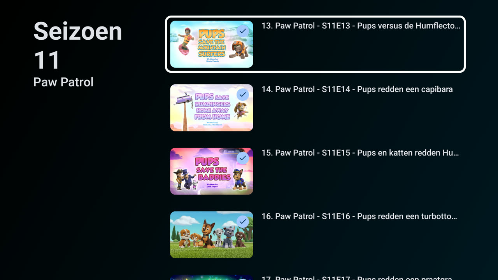 | Back from a season: focus on Play, scrolled to the top (finding 4)  |
| Back from Paw Patrol: focus on Keys (finding 4) 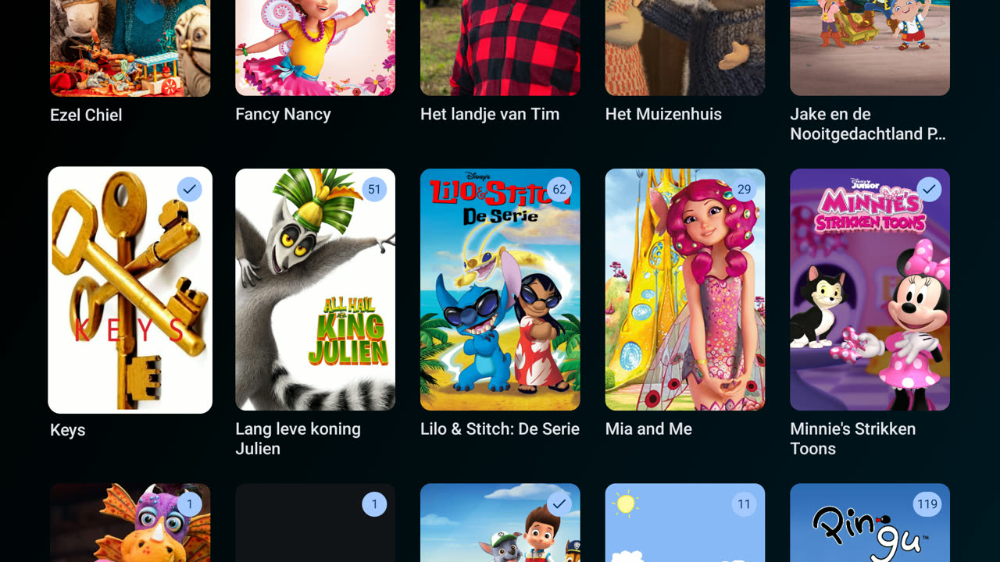 | Back from TV: focus on Collections (finding 4) 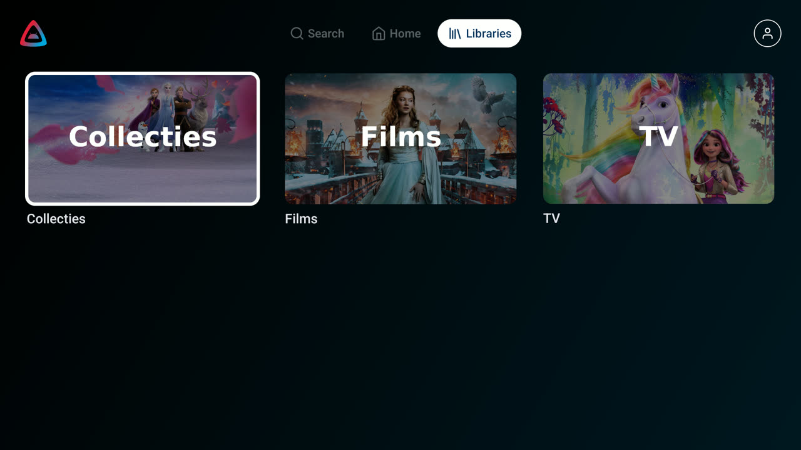 |
| OK on a collection does nothing (finding 5) 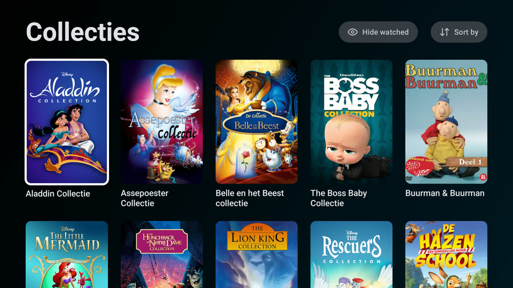 | Movie page 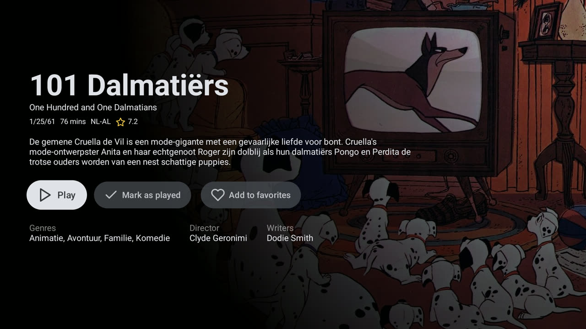 |
| Settings 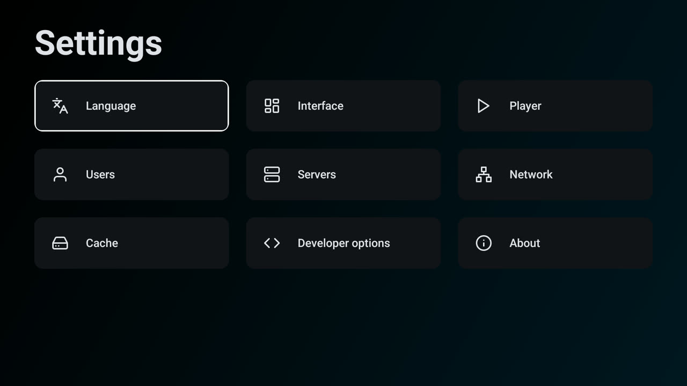 | Subtitle style 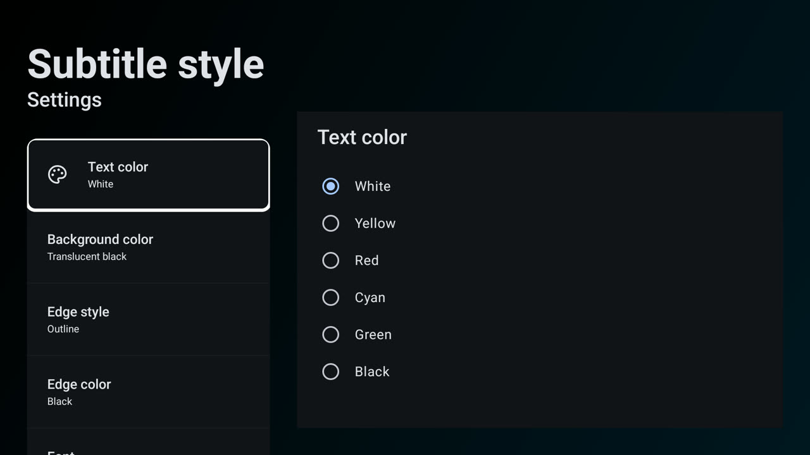 |
| Focus stops at "Play next episode automatically" (finding 6) 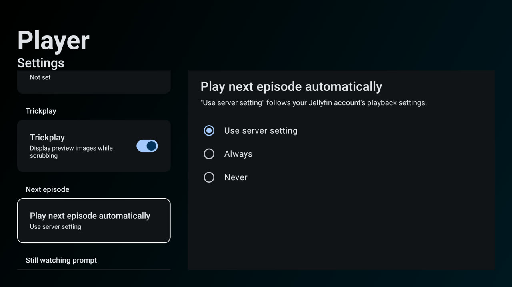 | Welcome 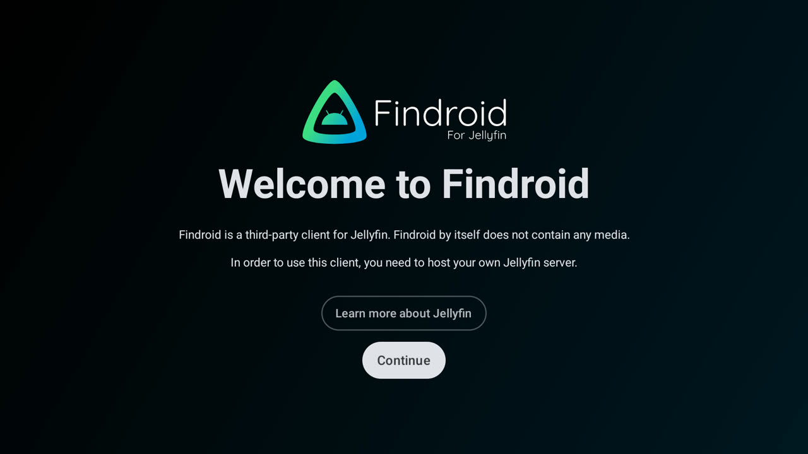 |
