# Phase 2: Wholphin study

Wholphin **v1.0.9** (`2d87d526`, the same version as on the Xiaomi box) on the same Android TV emulator (Android 14, 1080p), logged in to the Kiddos server and driven with D-pad, OK and Back only. The x86 build has no mpv, so this used ExoPlayer only. I also read the source at the `v1.0.9` tag.

### Licence (rule 6)

Wholphin's `LICENSE` is GPL-2.0. Findroid is GPL-3.0. The project doesn't say anywhere whether "or any later version" applies, so it's unclear whether we can copy code. **Recommendation:** we take ideas and behaviour, not code. If we ever want to copy a specific file, we ask the author first.

### Size and stack

| | Findroid CE `app/tv` | Wholphin |
|---|---|---|
| Kotlin files / lines | 57 / 7,034 | 398 / 90,326 (the whole app, TV only) |
| UI | Compose for TV (`tv-material` 1.1.0) | Compose for TV (`tv-material`) |
| Navigation | Navigation 3 | Navigation 3 |
| DI / player / images | Hilt / Media3 + mpv / Coil 3 | Hilt / Media3 + mpv / Coil 3 |

The stacks are almost the same, so everything below can be built in our setup without a new framework.

### What Wholphin does better, and how

**1. Focus is never lost** (our finding 4, rule 2)
- On the device: Back from the player lands on the same episode. Back from a show in the grid lands on exactly that show (Paw Patrol, same scroll position). Back from a show to Home lands on the same row. When the order changes because of new watch progress, focus lands on the right row and roughly the right card.
- How: every screen keeps a `RowColumn` position in `rememberSaveable` (`ui/Extensions.kt:335`, `rememberPosition()`). Every row has its own `FocusRequester` plus `focusRestorer()`, and on return a `LaunchedEffect` puts focus back on the saved row (`ui/main/HomePage.kt:310-347`). `ItemRow` remembers the column per row and restores it in `focusProperties { onEnter }`.
- For us: one shared helper (`rememberPosition` + `focusRestorer` on every row and grid) fixes finding 4 on every screen. This is the most important thing to take over.

**2. Seeking with the remote** (our finding 2)
- On the device: Right with the controls hidden jumps 30 s (13:17 → 14:54 after three presses), with a small skip indicator and a thin progress line at the bottom. With the controls shown, Left/Right moves along the seek bar.
- How: `PlaybackKeyHandler` handles Left/Right without controls, OK = pause/controls, media keys (FF/RW, next/previous, Captions, Audio track, Stop). Holding a key accelerates the seek with a multiplier that depends on the length (`SeekAcceleration.kt`: 1× → 10× for long films). Seek steps can be set, and there's a "seek bar with trickplay" mode.

**3. Player controls**
- Series logo top left, series name + episode line, "Ends at 3:29 PM" and remaining time, clock.
- Buttons: previous / rewind / play-pause / fast forward / next, settings, CC, audio. Down opens a **Queue row** with the next episodes, so you can jump straight to one.
- Dialogs (`PlaybackDialogType`): audio, captions, speed, video scale, subtitle delay, subtitle download, debug info. *The audio dialog didn't open on the test episode (it has one audio track). Not verified with several tracks.*

**4. Navigation: side drawer instead of top tabs** (our findings 10 and 11)
- A narrow icon rail on the left that expands into a drawer when it gets focus: user + server, Search, Home, Favorites, **each library by name**, Settings.
- Back on Home opens the drawer first (`NavDrawer.kt:297`) and doesn't close the app.
- A library has its own tabs: *Recommended / Library / Genres / Studios*. "Recommended" has rows per library (continue watching, recently added, top rated unwatched).

**5. Home and details**
- A large **hero area** above the rows shows the focused item: logo, title, `S1 E6 · date · 23m · 13m left · Ends at 3:32 PM`, with the backdrop changing with focus.
- **OK on an episode** opens the series with the season as a tab and focus on that episode, plus chips with technical info (`1080p · H264 · Dutch DD+ stereo`) and buttons: Play, Restart, Watched, Favourite, More. Playback doesn't start straight away (our finding 12).
- Show page: logo instead of a text title, studio, genres, buttons Play / Shuffle / Watched / Favourite / Trailer.
- A card without a poster shows the title (and an icon) as a placeholder (compare our finding 14).

**6. Library grid**
- 6 columns, title + year range below, progress bar, unwatched counter, check mark when watched.
- **A–Z jump bar** on the right and a **position counter** (`23 / 44`) at the bottom.

**7. Search** (our finding 1)
- Voice button, text field and filter. Results appear while typing, grouped per type (TV shows, episodes, …).

**8. Things that only make sense on TV** (from the source, not tested on the device)
- Android TV home screen **Watch Next** integration (`services/tvprovider`, `TvProviderWorker`).
- **Screensaver** (`WholphinDreamService`).
- **Theme music** for series, a **sound on focus** (optional).
- **PIN per user** (Quick Connect we already have on TV as well).
- **Customisable Home rows** (`HomeSettings`).
- **Refresh-rate switching** to the frame rate of the video.
- Live TV, music, photo slideshow, Jellyseerr integration (Discover), external player.

### What Wholphin doesn't do better

- The search screen puts focus on the voice button, and Left/Right in the text field moves the cursor, so you can't leave it with the D-pad. You have to press Back first.
- The clock top right overlaps the posters when the grid scrolls.
- The feature set is very broad (Seerr, music, photos, live TV). For CE that's no reason to copy everything (see the open questions in [0-plan.md](0-plan.md)).

### Feature matrix with the Wholphin column filled in

| Area | Feature | Phone CE | TV CE | Wholphin |
|---|---|---|---|---|
| Navigation | Structure | bottom bar | top tabs (switch only on OK) | side drawer with libraries |
| | Back on Home | n/a | exits the app | opens the drawer |
| | Search | yes | **empty tab** | yes, live, voice, filter |
| | Favorites | yes | no | yes |
| | Downloads / offline | yes | no | no |
| Home | Continue watching, Next up, Latest | yes | yes | yes |
| | Hero with focused item + backdrop | n/a | carousel only, no focus | yes, "ends at" |
| | Customisable rows | no | no | yes |
| Browse | Library grid, sort, filter | yes | yes | yes + genres, studios |
| | A–Z jump, position counter | no | no | yes |
| | Collections | yes | **dead end** | yes |
| Details | Episode page | yes | no | yes (series with season tab) |
| | Person page, cast | yes | no | yes |
| | Technical info (resolution, codec, audio) | partly | no | yes, as chips |
| | Play from beginning | yes | no | yes (Restart) |
| | Shuffle | no | no | yes |
| Player | Seek with D-pad | n/a | **no** | yes, 30 s + acceleration |
| | Audio / subtitle choice | yes | **dead buttons** | yes (+ delay, download) |
| | Trickplay | yes | no | yes |
| | Speed, scale | yes | no | yes |
| | Next/previous, queue row | partly | no | yes |
| | Skip intro/credits | yes | yes | yes |
| | Ends-at time | no | no | yes |
| | Media keys (CC, audio, FF/RW) | n/a | no | yes |
| TV integration | Watch Next / home channels | n/a | no | yes |
| | Screensaver | n/a | no | yes |
| | Refresh-rate switching | n/a | no | yes |
| | Theme music | n/a | no | yes |
| Account | Quick Connect | yes | yes | yes |
| | PIN per user | no | no | yes |
| Release | Published APK | yes | no | yes |

### Takeaways for phase 3 and 4

1. **Focus strategy (phase 4, decision 3):** take Wholphin's model. A saved `RowColumn` per screen, `focusRestorer` on every row and grid, and focus put back on return. Build it once as a shared helper in `app/tv`.
2. **Navigation (decision 2):** a side drawer with the libraries in it, and Back on Home opens the drawer. This fixes findings 10 and 11 together, and matches the Android TV convention.
3. **Player (decision 4):** we already have the hard part (shared `PlayerViewModel`, per-series tracks, segments). What's missing is the TV layer: a key handler like `PlaybackKeyHandler`, track dialogs, a queue row and an ends-at time. That makes the player the biggest win for the least work.
4. **Episode page instead of playing straight away:** the "series with season tab and focused episode" pattern fits better than a separate episode page.
5. **TV-only features** (Watch Next, screensaver, refresh rate) are "phase 5: polish". Watch Next is the most valuable of them, because it makes "continue watching" possible from the Android TV home screen.

### Phase 2 status

- [x] Wholphin installed and walked through with the remote on the emulator
- [x] Source read (navigation, focus, player, features)
- [x] Feature matrix filled in
- [x] Screenshots: see below.
- [ ] Not tested on the emulator: mpv, the audio dialog with several tracks, settings, Watch Next and the screensaver. Speed and memory are for the Xiaomi box, where Wholphin is already installed.

Next step: phase 3, the gap list with priorities.

### Screenshots

Wholphin v1.0.9 on the same emulator and server, scaled to 1280 px wide.

| | |
|---|---|
| Home with hero area for the focused item 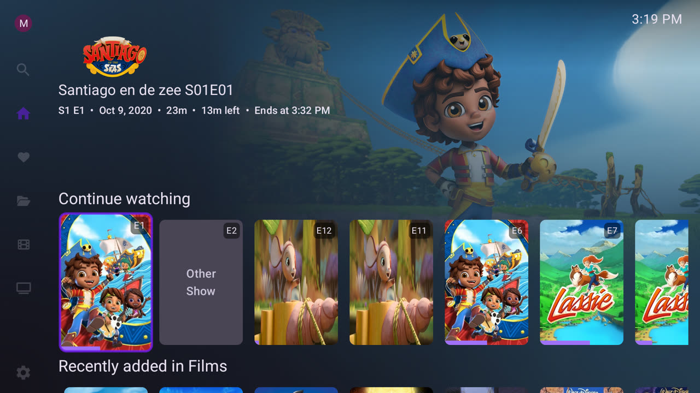 | OK on an episode opens the series, focus on the episode 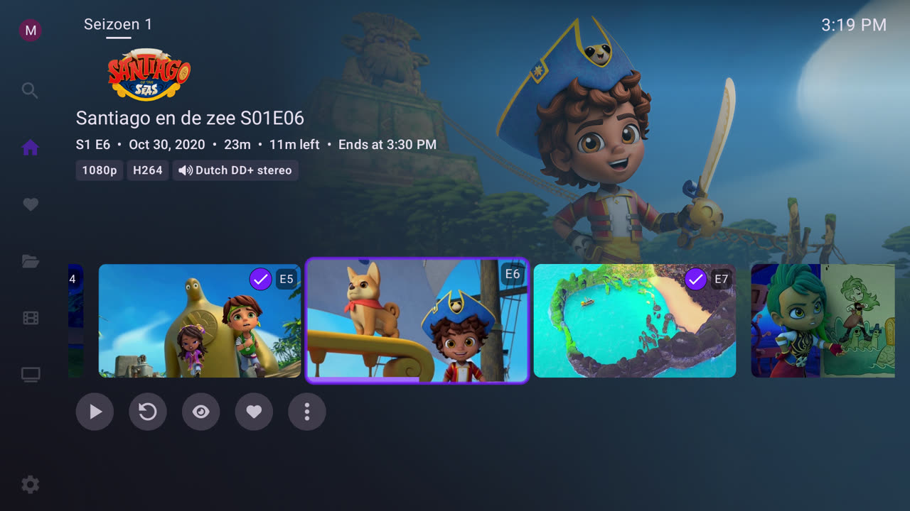 |
| Player controls 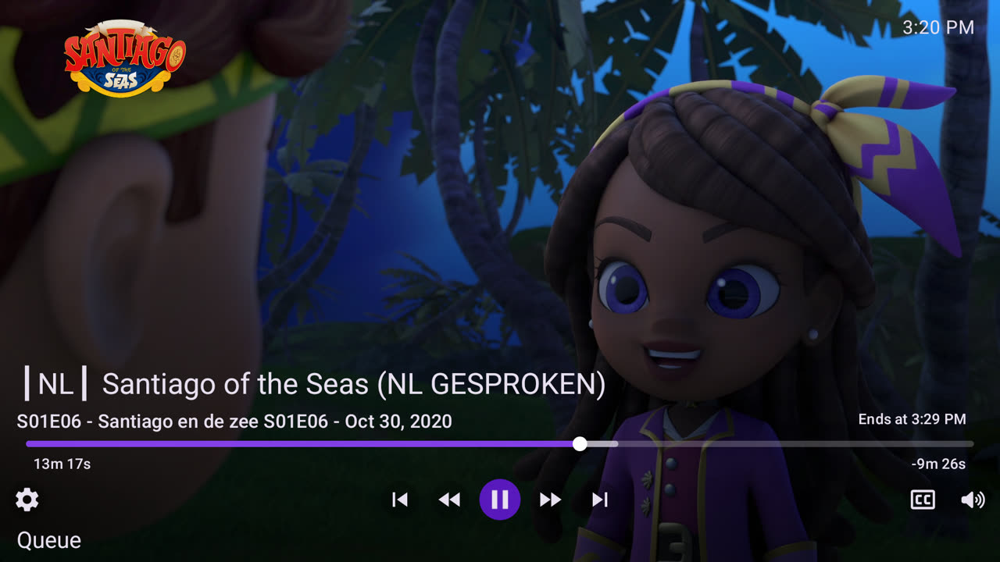 | D-pad seek with controls hidden: skip indicator 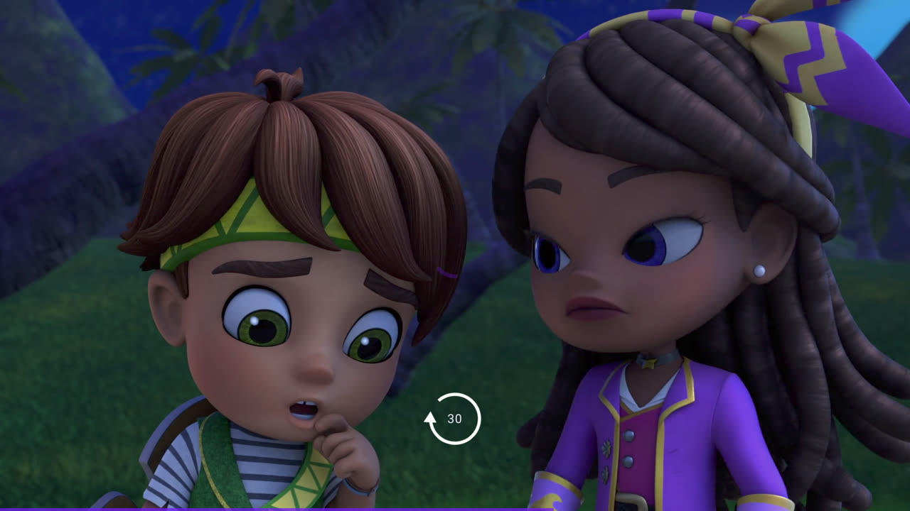 |
| After three presses of Right 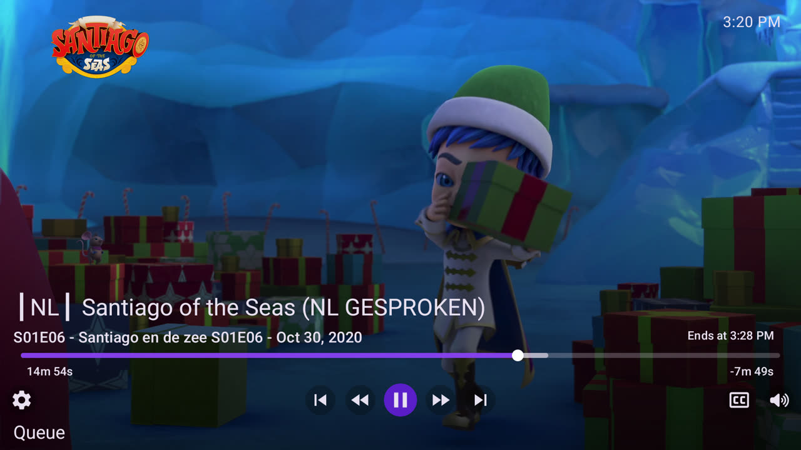 | Down in the player: queue row 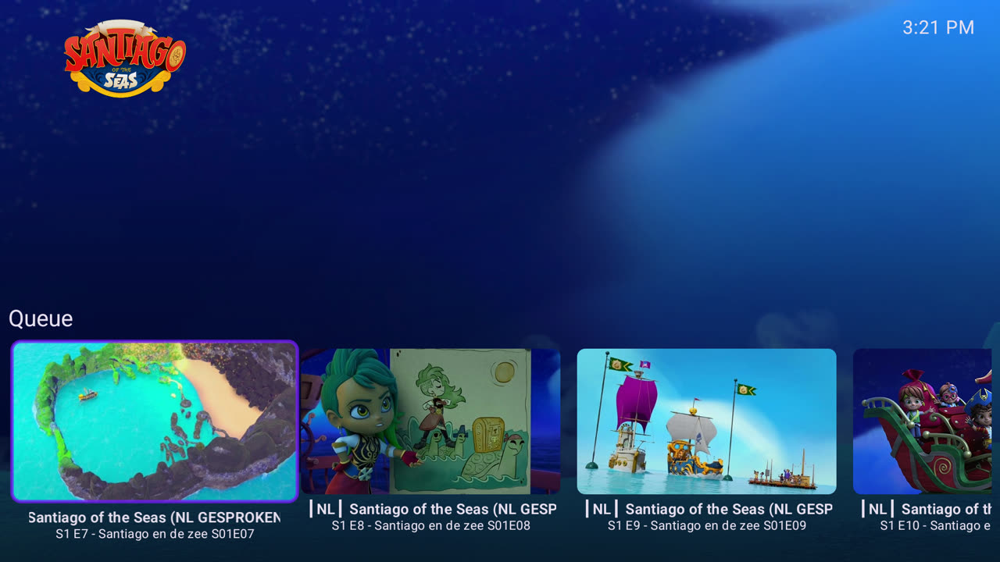 |
| Focus order in the player 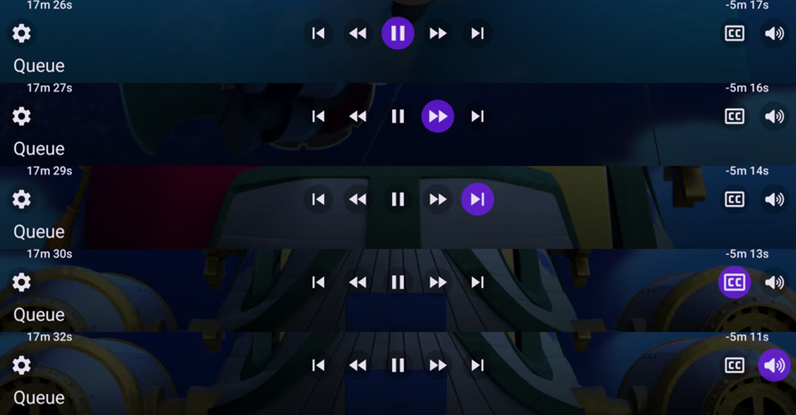 | Back from the player: focus kept on E6  |
| Navigation drawer 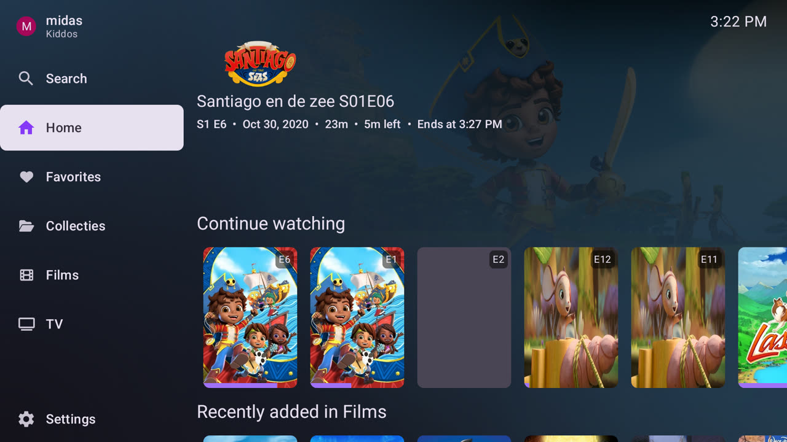 | Library, Recommended tab 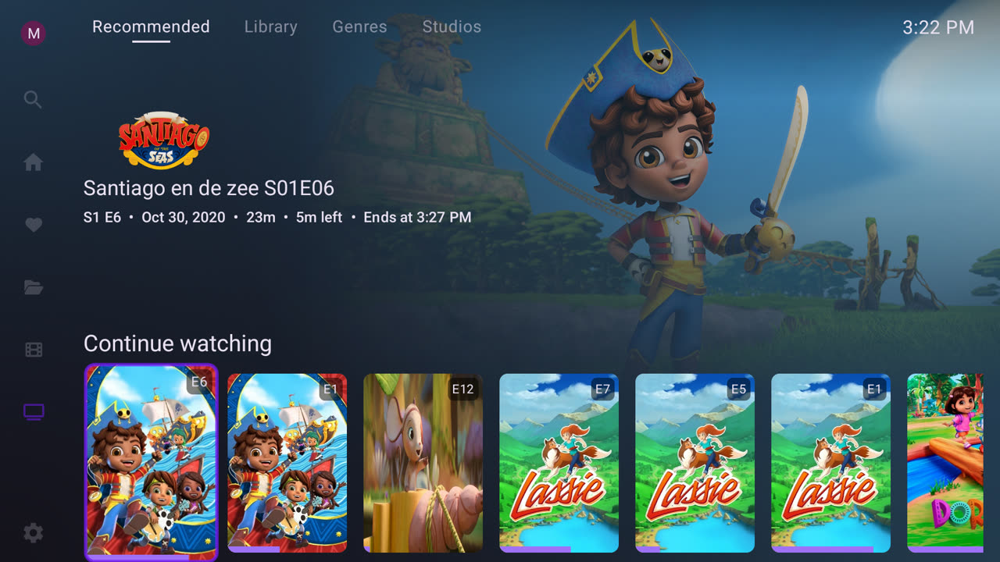 |
| Cards without artwork show the title 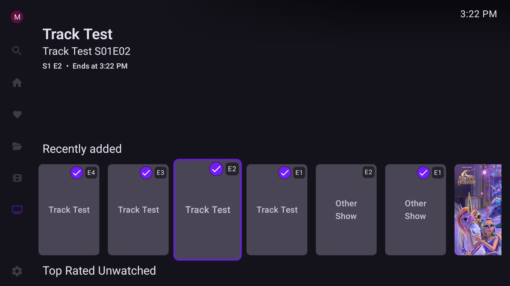 | Library grid with A–Z bar and counter 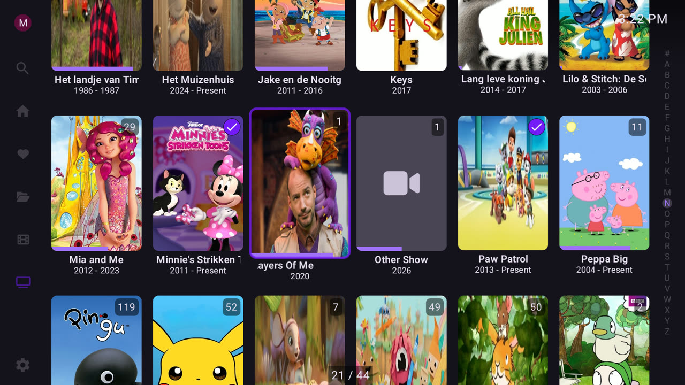 |
| Show page 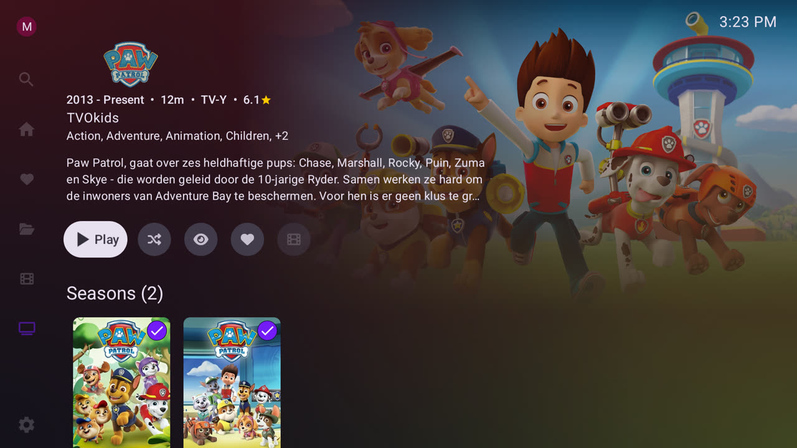 | Back from the show: focus kept on Paw Patrol 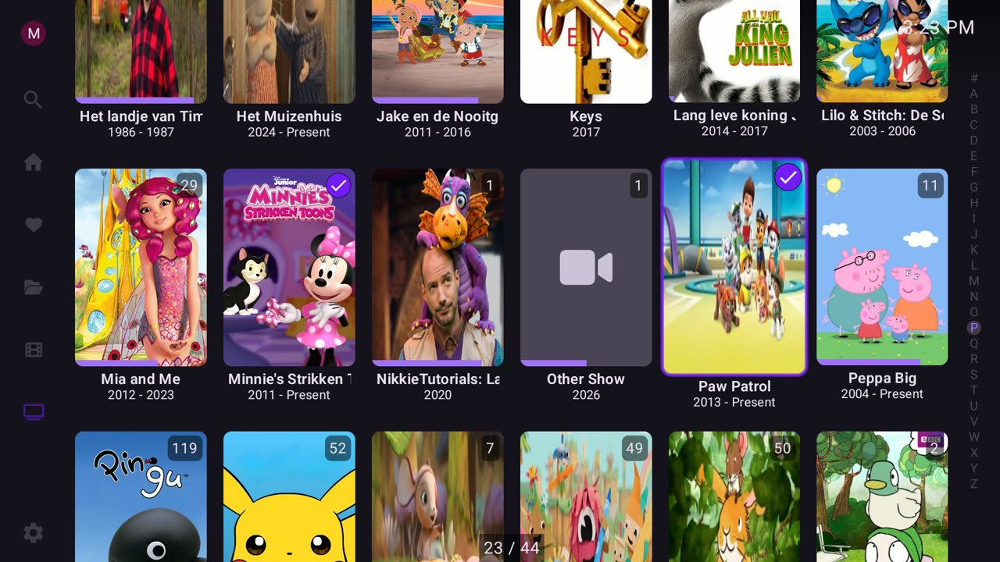 |
| Live search results 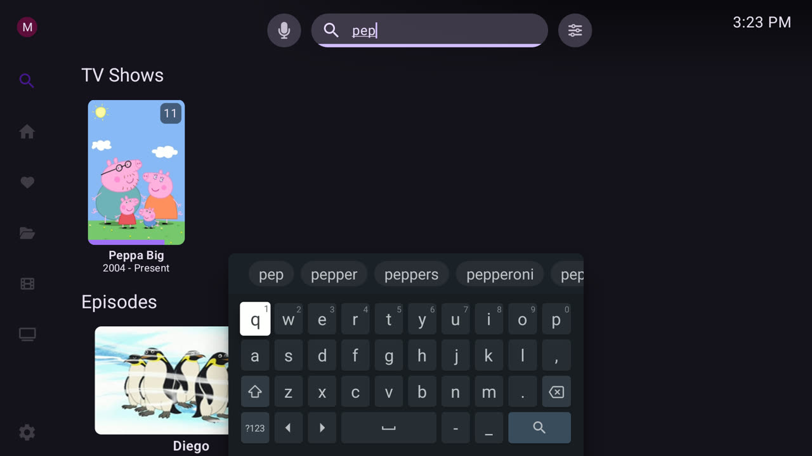 | |
